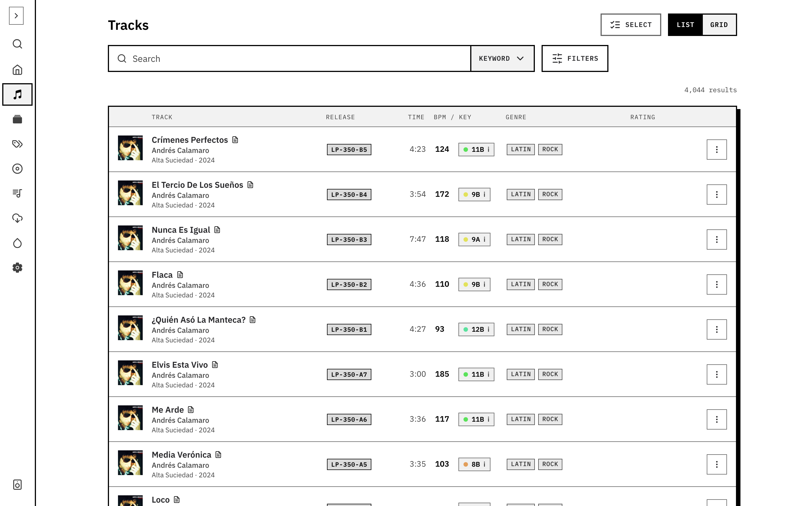
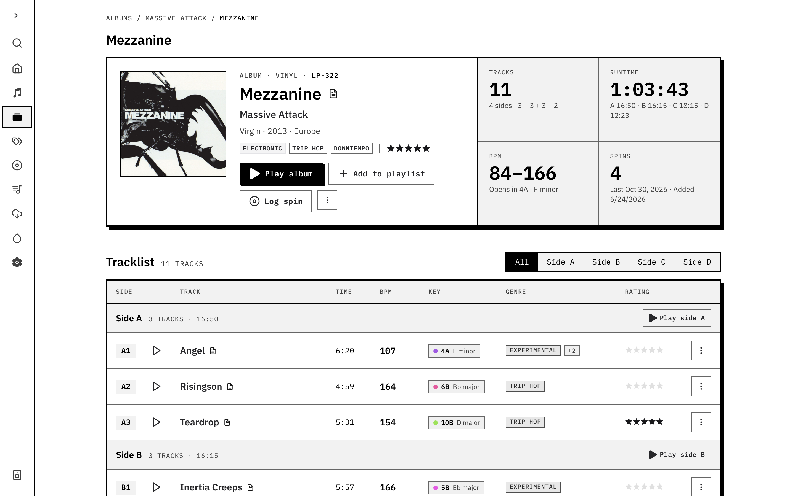
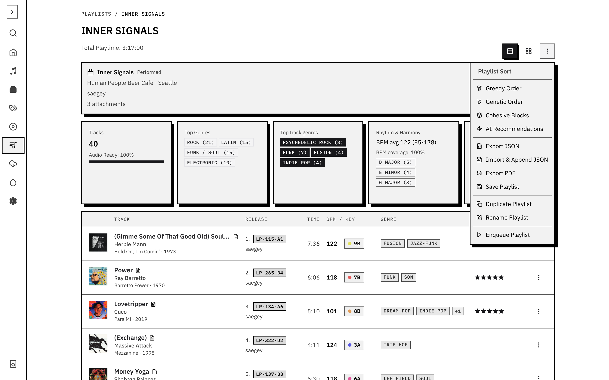
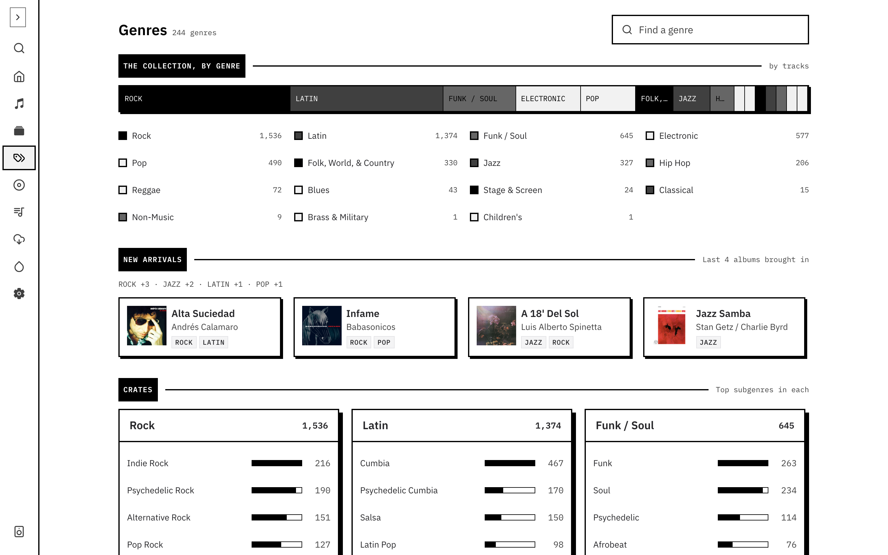

<p align="center">
  <picture>
    <source media="(prefers-color-scheme: dark)" srcset="site/src/assets/groovenet-wordmark-white.png" />
    
  </picture>
</p>

<p align="center">A self-hosted vinyl collection manager for DJs.</p>

<p align="center">
  <a href="https://groovenet.publicvinylradio.com">Website</a> ·
  <a href="https://groovenet.publicvinylradio.com/docs/">Docs</a> ·
  <a href="https://github.com/Public-Vinyl-Radio/groovenet/releases">Releases</a>
</p>

<p align="center">
  <a href="https://github.com/Public-Vinyl-Radio/groovenet/releases"></a>
  <a href="https://github.com/Public-Vinyl-Radio/groovenet/pkgs/container/webapp"></a>
  <a href="https://www.npmjs.com/package/@groovenet/cli"></a>
  <a href="https://www.npmjs.com/package/@groovenet/client"></a>
  <a href="https://www.npmjs.com/package/@groovenet/player"></a>
  <a href="https://github.com/Public-Vinyl-Radio/groovenet/actions/workflows/test.yml"></a>
  <a href="https://codecov.io/gh/Public-Vinyl-Radio/groovenet"></a>
  <a href="LICENSE"></a>
  <a href="https://app.netlify.com/"></a>
</p>

GrooveNet imports your Discogs collection, enriches it with streaming metadata, analyzes audio for BPM, key, and mood, and helps you build better DJ playlists. Use it in the web or iOS app, from the `groovenet` CLI, or through the MCP server.

## Screenshots

<table>
  <tr>
    <td width="50%"><picture><source media="(prefers-color-scheme: dark)" srcset="site/src/assets/screenshots/tracks-rows-desktop-dark.png" /></picture><br /><sub>Collection</sub></td>
    <td width="50%"><picture><source media="(prefers-color-scheme: dark)" srcset="site/src/assets/screenshots/album-desktop-dark.png" /></picture><br /><sub>Album</sub></td>
  </tr>
  <tr>
    <td width="50%"><picture><source media="(prefers-color-scheme: dark)" srcset="site/src/assets/screenshots/optimiser-desktop-dark.png" /></picture><br /><sub>Playlist optimiser</sub></td>
    <td width="50%"><picture><source media="(prefers-color-scheme: dark)" srcset="site/src/assets/screenshots/genres-desktop-dark.png" /></picture><br /><sub>Genres</sub></td>
  </tr>
</table>

## Features

- **Collection search** — fast full-text and fuzzy search with filtering and infinite scroll.
- **Metadata enrichment** — link Discogs releases to Apple Music, YouTube, and SoundCloud; bulk-edit and complete metadata with AI.
- **Audio intelligence** — analyze downloaded audio with Essentia for BPM, key, and mood.
- **Playlist tools** — generate transitions based on BPM, key, mood, and genre.
- **Collection sharing** — browse friends’ collections and keep a listening history.
- **Automation** — manage the collection through the CLI or MCP server.
- **Data ownership** — self-hosted PostgreSQL, backups, restore, and optional remote storage.

## Quick start

```bash
cp .env.example .env
docker compose up -d
```

Configure the required environment values, then open the app at <http://localhost:3000>. See the [setup guide](https://groovenet.publicvinylradio.com/docs/getting-started/) for configuration, importing a Discogs collection, and updates.

## What's in the repo

| Project                                           | Description                                            |
| ------------------------------------------------- | ------------------------------------------------------ |
| [Web app](my-collection-search/)                  | Self-hosted collection manager and API.                |
| [CLI](packages/groovenet-cli/)                    | Terminal client for managing GrooveNet.                |
| [MCP server](mcp-server/)                         | Connect GrooveNet tools to an assistant.               |
| [Now Playing player](packages/groovenet-player/)  | Desktop player and queue for GrooveNet.                |
| [iOS app](ios/DJPlaylistMobile/DJPlaylistMobile/) | Browse playlists and download tracks from your server. |
| [Brick preview](apps/groovenet-brick/)            | Native C++/SDL2 controller and desktop mock preview.   |
| [Site](site/)                                     | Website and product documentation.                     |

## Contributing

See [CONTRIBUTING.md](CONTRIBUTING.md) for the contributor workflow.

## License

GrooveNet is released under the [MIT License](LICENSE).
