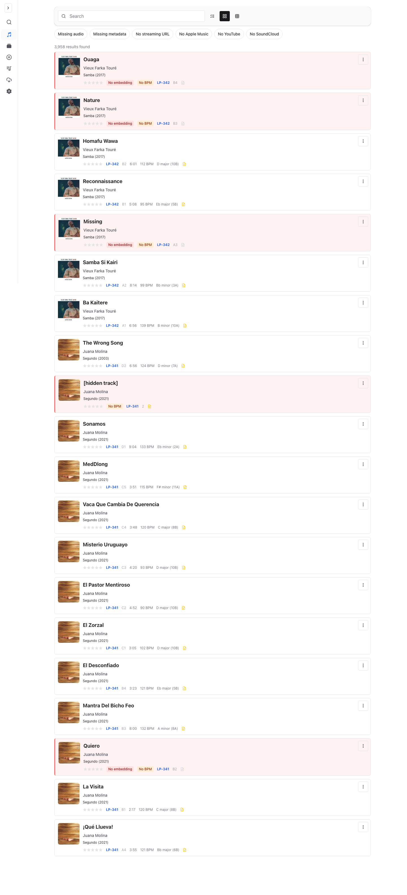
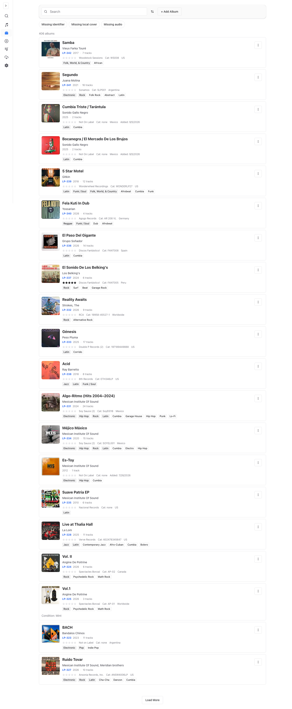
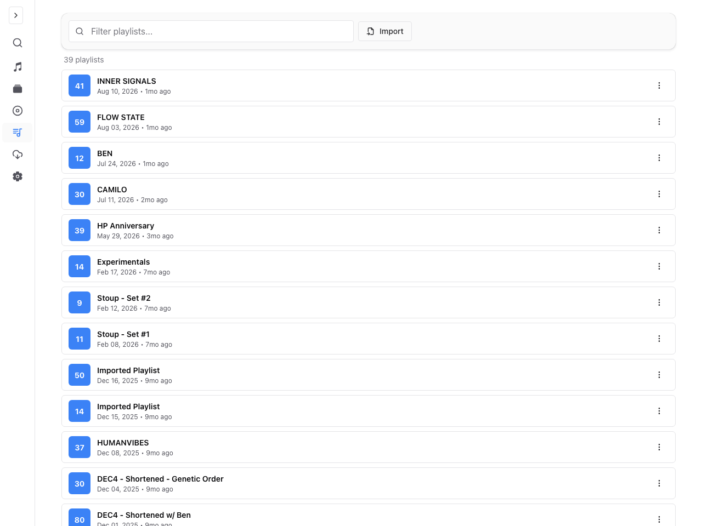
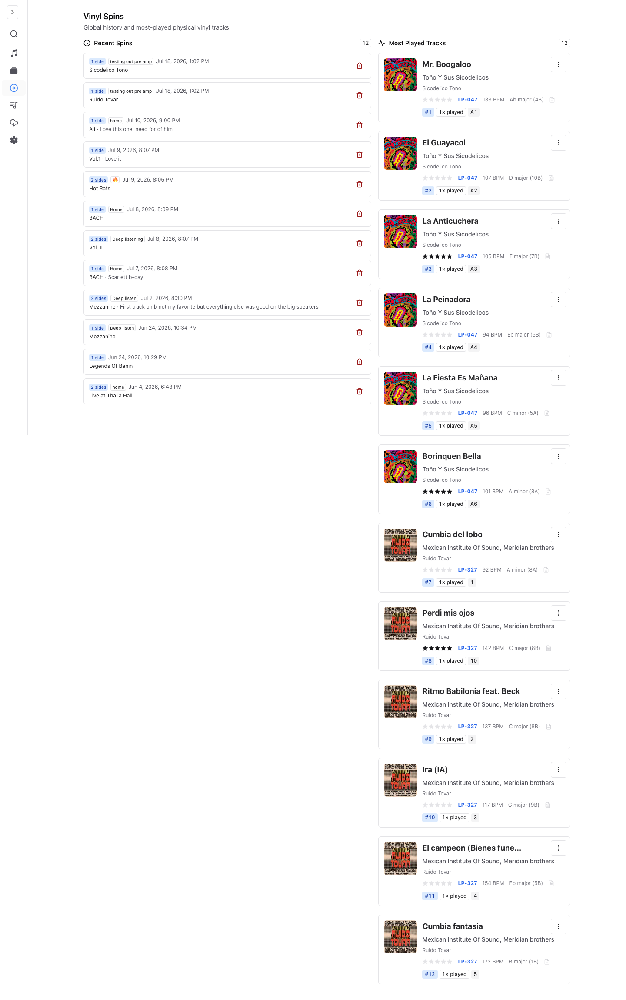

<p align="center">
  
</p>

<h1 align="center">GrooveNet</h1>

<p align="center">A self-hosted vinyl collection manager for DJs.</p>

<p align="center">
  <a href="https://github.com/Public-Vinyl-Radio/groovenet/releases"></a>
  <a href="LICENSE"></a>
  <a href="https://github.com/Public-Vinyl-Radio/groovenet/commits/main"></a>
  <a href="https://codecov.io/gh/Public-Vinyl-Radio/groovenet" ></a>
  <a href="https://github.com/Public-Vinyl-Radio/groovenet/actions/workflows/test.yml"></a>
</p>

GrooveNet imports your Discogs collection, enriches it with streaming metadata, analyzes audio for BPM, key, and mood, and helps you build better DJ playlists. Use it in the web or iOS app, from the `groovenet` CLI, or through the MCP server.

## Screenshots

<table>
  <tr>
    <td width="50%"><br /><sub>Collection</sub></td>
    <td width="50%"><br /><sub>Albums</sub></td>
  </tr>
  <tr>
    <td width="50%"><br /><sub>Playlists</sub></td>
    <td width="50%"><br /><sub>Listening history</sub></td>
  </tr>
</table>

## Run GrooveNet

The simplest self-hosted install needs [Docker Compose v2](https://docs.docker.com/compose/).

```bash
git clone https://github.com/Public-Vinyl-Radio/groovenet.git
cd groovenet

cp .env.example .env
# Edit .env: at minimum, set POSTGRES_PASSWORD and your Discogs values.

docker compose -f docker-compose.yml -f docker-compose.local.yml up --build -d
docker compose -f docker-compose.yml -f docker-compose.local.yml run --rm migrate
```

Open [http://localhost:3000](http://localhost:3000), then use **Sync from Discogs** to import your collection. The stack stores its database, audio, exports, backups, and cookies in Docker volumes.

### Required configuration

Set these values in `.env` before starting:

| Variable             | Purpose                                                                                              |
| -------------------- | ---------------------------------------------------------------------------------------------------- |
| `POSTGRES_PASSWORD`  | A strong password for the bundled database                                                           |
| `DISCOGS_USER_TOKEN` | Personal access token from [Discogs developer settings](https://www.discogs.com/settings/developers) |
| `DISCOGS_USERNAME`   | Your Discogs username                                                                                |
| `DISCOGS_FOLDER_ID`  | `0` for your full collection, or a specific folder ID                                                |

Apple Music, YouTube, OpenAI, backup, and analytics settings are optional. See [`.env.example`](.env.example) for the complete list and descriptions.

### Everyday commands

```bash
# Follow service logs
docker compose -f docker-compose.yml -f docker-compose.local.yml logs -f

# Stop the stack; your data remains in Docker volumes
docker compose -f docker-compose.yml -f docker-compose.local.yml down

# Update source, rebuild, and restart
git pull
docker compose -f docker-compose.yml -f docker-compose.local.yml up --build -d
docker compose -f docker-compose.yml -f docker-compose.local.yml run --rm migrate
```

The local override binds the app to `127.0.0.1:3000`. Set `APP_PORT=3001` in `.env` to use another port. Put GrooveNet behind your own reverse proxy to make it available on a network or public domain.

## Features

- **Collection search** — fast full-text and fuzzy search with filtering and infinite scroll.
- **Metadata enrichment** — link Discogs releases to Apple Music, YouTube, and SoundCloud; bulk-edit and complete metadata with AI.
- **Audio intelligence** — analyze downloaded audio with Essentia for BPM, key, and mood.
- **Playlist tools** — generate transitions based on BPM, key, mood, and genre.
- **Collection sharing** — browse friends’ collections and keep a listening history.
- **Automation** — manage the collection through the CLI or MCP server.
- **Data ownership** — self-hosted PostgreSQL, backups, restore, and optional remote storage.

## Clients and integrations

GrooveNet also includes an iOS SwiftUI app for connecting to a self-hosted server. It currently supports server setup, playlist browsing and generation, and local track downloads. See the [iOS app README](ios/DJPlaylistMobile/DJPlaylistMobile/README.md) for Xcode setup and current scope.

Install the CLI from npm:

```bash
npm install -g @groovenet/cli
groovenet config set api_base http://localhost:3000/api
groovenet tracks search "acid house" --bpm-min 120 --bpm-max 135
```

The [CLI README](packages/groovenet-cli/README.md) covers all commands. The [MCP server README](mcp-server/README.md) explains how to connect GrooveNet to an MCP client.

## Development

For contributing or running the hot-reload stack, install [mise](https://mise.jdx.dev/) and [just](https://github.com/casey/just):

```bash
mise install
just bootstrap
just compose-dev
just migrate-up
```

Node 26 and npm 12.0.1 are selected by `.mise.toml`. The exact `engines.npm`
pins in the root and app manifests must match it: the shared
`.github/actions/setup-npm` action installs the root pin for every JavaScript
dependency job, including publishing, and the Docker base installs the app pin
for all stages (deps, builder, runner and migrator). New CI install jobs should
use that action. Docker publishing calls the same test workflow before building.

`engines.npm` is advisory under npm's default configuration; it does not install
or enforce npm by itself. Bootstrap and CI run
`node scripts/check-npm-toolchain.mjs` before dependency installs to fail on
manifest/mise/runtime drift, and Docker asserts its installed version. There is
no Corepack/packageManager convention here; mise selects the local executable.
When updating npm, change all three pins together and the npm entry in
`mise.lock` via mise, then verify clean root and app installs plus Docker's
`deps` and `migrator` targets. Run the drift-check tests with
`mise exec -- node --test --experimental-test-coverage --test-coverage-include=scripts/check-npm-toolchain.mjs scripts/npm-toolchain.test.mjs`.

Bootstrap, package tests and dev-container startup use strict `npm ci`, which
must leave tracked lockfiles unchanged. The root lockfile owns `packages/*`
and `mcp-server`; the app has its own lockfile. The legacy
`mcp-server/package-lock.json` is not used by workspace installs. Dependabot's
configuration does not force its npm version: its PRs must pass actual installs
under our pin. Pinning cannot repair dependency/lockfile inconsistencies; fix
those separately under the pinned npm without unrelated dependency updates.

The dev Compose override builds the `dev` image target, skipping production
Next.js and Storybook builds. On startup it installs into `dev_node_modules`
only when the app manifest, lockfile, contracts manifest, or Node/npm toolchain
changes. A fresh volume always installs; failed installs retry on the next
start. To force a reinstall, remove `/app/node_modules/.groovenet-install` in
the app container and restart it. The container never builds
`@groovenet/contracts` or `@groovenet/client`: it mounts both read-only and
uses the `build/` output from `just bootstrap`, refusing to start without it.
After changing either package, rebuild it on the host
(`npm run build --workspace=@groovenet/contracts`).

The whole repo uses one TypeScript, the 6.x API package
(`npm:@typescript/typescript6`), which installs a `tsc6` binary. TypeScript 7
has no JavaScript compiler API, and typescript-eslint (including the copy
bundled by `eslint-config-next`) needs that API. Next.js 16 itself can type
check with TypeScript 7. Keep every `typescript` entry on the same alias so the
root workspace hoists a single copy and no package gets a nested
`node_modules`. Move everything to 7 together once typescript-eslint supports it.

`mise.lock` carries checksums for every platform it lists, so `mise install`
leaves it unchanged. After changing `.mise.toml`, run `mise lock` and commit
the result. The `bootstrap` workflow runs `just bootstrap-js` and fails if
`mise.lock` or either npm lockfile changes, or if TypeScript stops hoisting.

`just bootstrap` installs a git pre-commit hook that runs file hygiene checks,
[ruff](https://docs.astral.sh/ruff/) over the Python services and Python client,
ESLint over changed web and Node package files, and the formatters below. The
same hooks run in CI, so the hook only moves the feedback earlier — skip it with
`git commit --no-verify` and CI will still catch it.

### Formatting

[Prettier](https://prettier.io/) formats TypeScript, JavaScript, JSON, YAML,
Markdown and CSS from one root config, `.prettierrc.json`: 100 columns, double
quotes, semicolons and trailing commas. `ruff format` formats the Python
services and client at the 120 columns `ruff.toml` sets. `.editorconfig` gives
editors the same line endings and indents.

```bash
just format        # rewrite tracked files in place
just format-check  # fail on anything unformatted, without writing
```

Both cover tracked files only. `.prettierignore` skips files a tool owns:
lockfiles, release-please's changelogs and manifest, test fixtures, snapshots
and vendored skills. Build output is ignored through `.gitignore`. Every ESLint
config ends with `eslint-config-prettier`, so ESLint never reports layout.
Prettier runs after ESLint `--fix` and `ruff format` after `ruff check --fix`,
so a formatter always has the last word.

Point your editor at the root `node_modules/.bin/prettier` so it uses the
pinned version. After rebasing a branch across a reformat, run `just format`
and commit the result.

Useful checks:

```bash
just test
just lint          # web app, client, CLI and MCP server
just typecheck
just lint-all      # every pre-commit hook, over the whole repo
just format-check
```

Worktree setup, deployment, releases, and operator-specific overrides are maintainer workflows; see [`AGENTS.md`](AGENTS.md), [`RELEASING.md`](RELEASING.md), and the package-level READMEs when you need them.

### Storybook

Every production app image builds and verifies a static Storybook bundle from its
checkout before building Next.js, then packages it in `public/storybook`.
With `ENABLE_DEVELOPER_TOOLS=true`, the Developer Tools card opens
`/storybook/index.html` on the running app. CI candidates, promoted releases,
self-hosted builds and local deployment builds use the same Dockerfile; none
needs a separate host build. This adds a Storybook build and about 10 MB of
static assets to app images; the migrator target does not build Storybook.
Storybook has a separate build stage, so backend changes reuse its verified
bundle. Shared frontend or story changes rebuild it. Dev containers use the
separate Storybook server described below.

For component development, run `just storybook` in a separate terminal. It uses
the pinned toolchain, serves at `http://localhost:6006`, and needs no Compose
services. To use the Developer Tools link in a hot-reload app, set
`ENABLE_DEVELOPER_TOOLS=true` and `STORYBOOK_URL=http://localhost:6006` in `.env`.
When using the 1Password template, export `STORYBOOK_URL=http://localhost:6006`
before `just compose-dev` or `just worktree-up`. Restart the app after changing
its environment. Multiple worktrees can run their own server with
`mise exec -- npm run storybook --prefix my-collection-search -- --port 6007`
and a matching URL. For remote browsers or HTTPS apps, use an accessible URL
and matching scheme instead of the browser's localhost.

`just build-storybook` then `just check-storybook-render` loads every story in headless
Chromium, light and dark, and fails on any that errors at render. CI runs both; the image
build has no browser, so it only runs the bundle check.

`STORYBOOK_URL` remains a server-side runtime setting: root-relative paths and
HTTP(S) URLs are supported without rebuilding the image. An empty value hides
the card (the bundle remains available); `ENABLE_DEVELOPER_TOOLS` gates the
Developer Tools page/navigation, not static assets. Same-origin Storybook goes
through the app's existing reverse proxy and its access controls; an external
URL uses that server's access controls.

`STORYBOOK_STATIC_DIR` is retired and ignored by production Compose. Remove it
from existing deployment environments. The image's bundle is authoritative;
mounting a host directory over `/app/public/storybook` would hide it. To serve
an independently managed catalogue, host it separately and set `STORYBOOK_URL`
to its URL. Recreate the app with the updated Compose files to remove the old
mount; pulling an image alone does not change an existing container's mounts.

`just build-storybook` optionally builds and verifies
`my-collection-search/public/storybook` for local static inspection. This output
is ignored by Git and Docker so it cannot contaminate a release build. Run
`mise exec -- npm run test:storybook --prefix my-collection-search` for bundle
validator coverage and merged Compose regression checks (Docker Compose is
required for those checks).

### Python API client

`packages/groovenet-python` is a small hand-written `groovenet_client` package
used by download-worker and fingerprint-service. App requests share a
`requests.Session`, send `X-Groovenet-Client: worker`, and raise
`GroovenetApiError` for every non-2xx response. Services own retries and
best-effort delivery. Both Docker builds use the repository root as context.

When a Python worker needs an endpoint, add its payload type and thin method,
then exact-request and error tests; see
[the client guide](packages/groovenet-python/CLAUDE.md). `just generate-spec`
updates the OpenAPI contract used by the path/verb tests; no Python code is
generated.

```bash
just test-python-client
```

## Contributing

Contributions are welcome. Please open an issue to discuss larger changes, keep migrations with schema changes, and run the checks above before opening a pull request. See [the license](LICENSE) for reuse terms.

## License

GrooveNet is released under the [MIT License](LICENSE).
