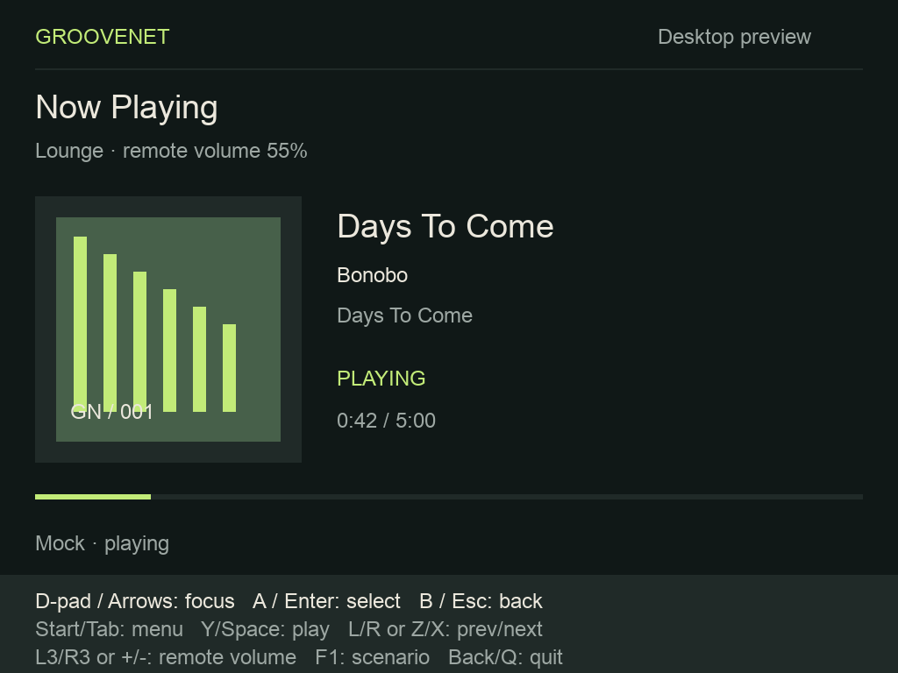
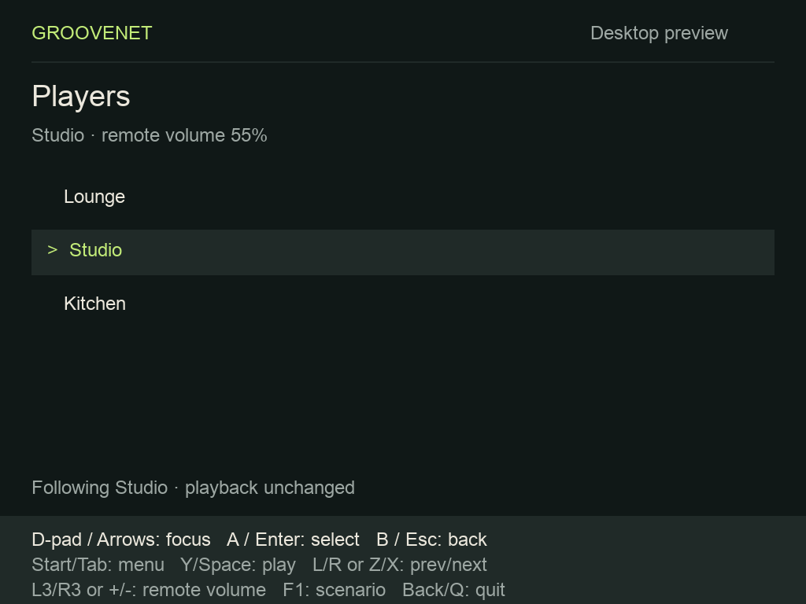
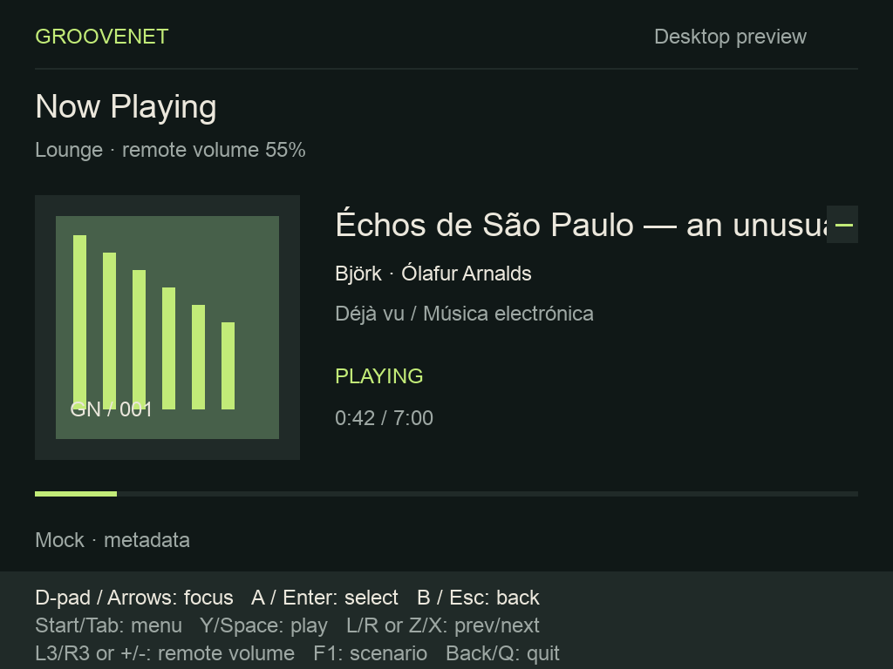

# Groovenet Brick preview

The native C++17/SDL2 application foundation for #1096. Desktop and future device
launchers share the application, data-adapter interface and SDL renderer. This
preview has deterministic mock data and a live REST/SSE adapter; audio stays on the server.

## Knulli device preview

`just brick-package` produces the experimental ARM64 Ports archive, independently
of npm and desktop builds. See [install/build/control instructions](knulli/README.md)
and [application device evidence](evidence/knulli-preview-1107.md) for hashes,
firmware/ABI limitations, physical observations and remaining acceptance checks.
The device profile uses the same renderer and REST/SSE adapter. It supplies a
licensed DejaVu font and maps remote volume to D-pad Up/Down on Now Playing.
Desktop mode retains its existing mappings below.

## Host setup and commands

Supported development host: macOS with Xcode command-line tools and Homebrew.
Linux CI uses Ubuntu 24.04 with SDL's dummy video driver.

```sh
brew install cmake pkg-config sdl2 sdl2_ttf curl json-c libpng jpeg-turbo
just brick-preview
just brick-preview --scale 0.75 --scenario metadata
just brick-test
just brick-coverage
```

Linux dependencies: `cmake clang llvm pkg-config libsdl2-dev libsdl2-ttf-dev
fonts-dejavu-core libcurl4-openssl-dev libjson-c-dev libpng-dev libjpeg-dev python3 openssl`. Requires SDL2 and SDL2_ttf >= 2.0.18, CMake >= 3.20 and a C++17
compiler. Native dependencies are independent: existing npm bootstrap, builds and
tests do not invoke CMake or require SDL. Build output stays in this directory's
ignored `build/` and `build-coverage/` directories.

The default font is system Arial on macOS and DejaVu Sans on Linux. Override with
`--font /absolute/path/font.ttf` for another host or script. Supply a font with
appropriate glyph coverage for the metadata languages you need; SDL_ttf renders
UTF-8, but a font cannot render glyphs it does not contain. The Knulli package separately includes redistributable DejaVu Sans and its license; no macOS font is distributed.

## Display and input

The logical canvas is **1024×768**, matching the Brick panel documented in the
[TRIMUI Brick TG3040 manual](https://ae-pic-a1.aliexpress-media.com/kf/S708858c6482e484a8670e62d58ae775dM.pdf).
`--scale 0.5` through `--scale 3` changes the initial window size; resizing
letterboxes the same logical canvas, including on Retina displays. The #1095
probe used a 640×480 test canvas, not the panel's native dimensions. The experimental device preview is tracked in #1107; full supported-release
qualification remains in #1102.

| Named action                                       | Keyboard                | SDL game controller               |
| -------------------------------------------------- | ----------------------- | --------------------------------- |
| Focus up/down (lists); remote volume (Now Playing) | Arrow up/down           | D-pad up/down                     |
| Select                                             | Enter                   | A                                 |
| Back                                               | Escape                  | B                                 |
| Browse menu                                        | Tab                     | Start                             |
| Play/pause                                         | Space                   | Y                                 |
| Previous/next                                      | Arrow left/right or Z/X | D-pad left/right or shoulders L/R |
| Remote player volume down/up                       | Minus/plus (or equals)  | Left/right stick click (L3/R3)    |
| Cycle mock scenario                                | F1 (Fn-F1 on some Macs) | Use CLI scenario at launch        |
| Quit preview                                       | Q or window close       | Back/Select button                |

These are SDL semantic controller positions, not guesses about Knulli raw button
IDs. SDL-recognized controllers work at startup and can be connected/disconnected
while running. Unrecognized controllers need an SDL mapping supplied by the host
(for example `SDL_GAMECONTROLLERCONFIG`); analog sticks are not required for
navigation. Keyboard repeat is ignored to avoid repeated playback commands.

**Server volume**, including Up/Down on Now Playing, affects only the selected server player's 0–100 level in
steps of five. OS multimedia volume keys and Power are never mapped to server
volume, pause or stop. **Local device volume** belongs to the firmware/OS adapter
and has no application command here. Nothing essential requires mouse input.

Tab opens Browse with Now Playing, Players, Playlists, Queue and Outputs. Focus
wraps within each list and is remembered per screen. Enter selects, Escape
returns to the previous screen, and Escape at the initial Now Playing screen
stays there. Selecting a player is observational and leaves playback unchanged.
Playlist, queue and output rows are navigation shells; selecting them displays a
notice rather than pretending to send a server mutation. Their commands follow
in #1099–1101. Button hints remain visible on every screen.

Losing window focus simulates a suspended UI; focus gain requests an adapter
refresh. Quit, suspend and wake never issue playback commands. The mock clock
pauses while the preview is suspended. A real server's clock/playback will keep
running; the live adapter must replace local state with a fresh snapshot on wake.

## Mock scenarios and live configuration

`--mode mock` is the default. F1 cycles through this fixed sequence, resetting
the fixture and all list focus, without using randomness or network requests:

| `--scenario`       | Fixture                                                         |
| ------------------ | --------------------------------------------------------------- |
| `playing`          | Lounge playing a three-track queue at 0:42, volume 55           |
| `paused`           | Same queue, stopped clock; Space resumes                        |
| `empty`            | Empty queue; playback commands have no effect                   |
| `loading`          | Loading message; transport/volume disabled                      |
| `disconnected`     | Disconnected with retained metadata; commands disabled          |
| `unavailable`      | Selected player unavailable; commands disabled                  |
| `metadata`         | Long title and accented UTF-8 artist/album metadata             |
| `missing-artwork`  | Explicit artwork fallback                                       |
| `refreshing`       | Last known state retained with commands disabled while updating |
| `missing-metadata` | Empty title/artist/album during live refresh; renders safely    |
| `artwork`          | Decoded RGBA upload path, including allocation-failure fallback |
| `speaker-busy`     | Acknowledgment panel blocks commands until Select/Back          |
| `unknown-timing`   | Unknown duration, no progress fraction or invented total        |

The playing clock advances from elapsed milliseconds; track end, Next and
Previous rotate the fixture queue and reset timing. Long text is clipped at a
fixed readable size with a continuation mark, without splitting UTF-8 bytes.
The artwork fixture is deterministic SDL geometry, requiring no downloaded files.

`just brick-preview --mode live` runs the asynchronous native client. Provision a
launcher environment with `BRICK_URL` (app origin, **without `/api`**),
`BRICK_PLAYER_KEY` (the server's `PLAYER_API_KEY`), and, where collection API
authentication is enabled, `BRICK_COLLECTION_KEY` (the collection API key).
Player credentials are never substituted for collection credentials. OwnTone
URLs/passwords remain entirely on the server. Keep the launcher environment file
outside the checkout, owner-readable only (`chmod 600`), and source/export it
before starting the app. Do not put tokens in CLI arguments, screenshots or logs.
The app does not write secrets to its SDL configuration directory.

Use HTTPS outside loopback development. The host libcurl trust store and hostname
verification are enabled by default. For a private CA, provision its PEM bundle
and set `BRICK_CA_FILE` to its absolute path; keep the hostname matching the
certificate and the device clock accurate. Explicit `BRICK_INSECURE_TLS=1`
disables verification for a development session only. Redirects are refused so
credentials cannot follow a redirect to another origin. Invalid configuration
appears in application state; diagnostics never echo credentials/server bodies.

On first launch, open Browse → Players and explicitly choose a named player.
Rows include the stable ID and mark the current selection. No player is selected
automatically, even when only one exists. Selection only observes state: it does
not start playback, join a local queue, change outputs or claim speakers.
The selected ID and server URL are atomically saved in `selected-player` under
the platform's SDL configuration directory. No credentials are saved. Restart
opens that player's Now Playing screen; a removed player or unavailable backend
never causes a fallback to another player. A save failure remains visible while
following the chosen player for the current session.

The worker lists players, fetches selected detail and subscribes to its SSE. The
first valid stream snapshot enables controls. Selecting a player and waking
cancel the old request, discard unsent work, and obtain fresh state. Reconnects
use 250 ms exponential backoff capped at 8 s; every connection starts without a
replay ID and requires a fresh snapshot. A changed worker identity refreshes the
session, and stale sequence/revision/current-entry position updates are ignored.
Now Playing interpolates valid playing timing between authoritative updates,
preserving fractional seconds, clamping to duration and freezing after five
seconds without a timing update. Paused, disconnected, refreshing and unknown
or zero-duration states do not interpolate. Metadata completion cannot reset the
progress clock. Quit cancels/joins both workers and never stops playback.

Requests have a 3 s connect and 8 s total deadline; SSE connections rotate after
30 s. Cancellation interrupts idle transfers through libcurl's progress callback
(typically within a second, with the connect deadline bounding DNS/connect).
Responses and individual SSE events are bounded at 2 MiB, player lists at 1,000,
and queues at 10,000. Input only queues one command; all HTTP, parsing and
metadata work runs on the worker. Snapshot publication uses a mutex, and the UI
copies the latest state during `advance()`.

Commands carry the last authoritative `expected_revision`; playback and volume
are never changed optimistically. A command is attempted **once**. This includes
skip, queue add/replace and explicit takeover submitted through `RestClient` and
`PlayerState::command`. On timeout, lost response or conflict, refresh state and
let the user deliberately retry. A lost response may mean the write committed.
The adapter does not automatically approve takeover/unknown speaker conditions.
Speaker-busy, availability-unknown, engine-busy and revision conflicts open an
acknowledgment panel. Playback/volume input is blocked until A/Enter acknowledges
or B/Esc dismisses it. Acknowledgment sends no command and grants no policy
exception: deliberate speaker/engine takeover belongs in the web controller.
The Brick never sends `takeover` or `allow_unknown`, retries an ambiguous write,
or changes speakers as a side effect of acknowledging a warning.
Unauthorized, missing player, revision/speaker conflict, unavailable service and
no-audio errors appear as state, with controls disabled until fresh state arrives.

### Existing collection API audit

| Need                                      | Existing API / contract                                                                                             |
| ----------------------------------------- | ------------------------------------------------------------------------------------------------------------------- |
| Playlist listing                          | `GET /api/playlists`                                                                                                |
| Playlist details and composite track refs | `GET /api/playlists/{id}/tracks`                                                                                    |
| Track metadata and playable availability  | `POST /api/tracks/batch`, body `{"tracks":[{"track_id":"…","friend_id":1}]}`; array response with `local_audio_url` |
| Individual track                          | `GET /api/tracks/{id}?friend_id=…`                                                                                  |
| Artwork metadata                          | Track `album_thumbnail`; audio metadata also exposes embedded cover information                                     |

`RestClient` exposes playlist reads and composite track enrichment. The live
adapter enriches the current entry, keeping a one-track metadata cache per
connection, keyed by **both** track ID and friend ID. Missing `local_audio_url`
means no playable local audio; a missing batch row is not a playable track.
Queue snapshots supply title/artist and refs, not album/artwork. Collection
authorization or metadata failure leaves player control available and shows a
metadata warning. A separate worker fetches metadata and artwork; changing the
player, current queue entry, track reference or session generation cancels old
work and rejects its results before publication. PNG/JPEG artwork is limited to
2 MiB encoded and 1024×1024 RGBA decoded. Unsupported, invalid, oversized or
unavailable images render the artwork placeholder. HTTP and decoding stay off
the render loop; the renderer uploads one texture when the image changes.
Only same-origin artwork requests may carry the collection credential; external
image hosts receive no credentials, HTTPS downgrade is refused, and redirects
remain disabled. Player credentials never accompany artwork requests.
No backend endpoint gap was found for this client slice.

## Manual preview and captures

1. Start `just brick-preview --scenario playing`. Check the cover, 0:42 progress,
   title and persistent hints. Space pauses/resumes; Z/X change the fixture track;
   +/- changes **remote** volume. Leave the window focused to watch track timing.
2. Tab, Down, Enter opens Players. Down, Enter follows Studio without starting or
   stopping playback. Escape returns with Browse focus still on Players.
3. Visit Playlists, Queue and Outputs with the same controls. Confirm each shell
   shows a focused row and returns consistently. Selecting a row shows its scope
   notice; it never alters speaker routing or starts a playlist.
4. Cycle F1 through every scenario. Check empty/loading/error states, missing
   artwork, metadata clipping and unknown timing. Resize the window and try
   `--scale 0.5` and `--scale 2`.
5. Plug/unplug a mapped controller; repeat selection/back and playback controls.
   Defocus/refocus the window to exercise suspend/wake. Quit with Q, controller
   Back, or window close; no player playback command is issued.
6. Launch `--mode live` and confirm the connecting/error state, then check player list, fresh Now Playing,
   play/pause, volume and reconnect against a development player.

Scripted capture uses the same application action path with a frozen clock. It
runs without a display and exits after the requested number of frames:

```sh
just brick-preview --frames 1 --screenshot /tmp/brick-playing.bmp
SDL_VIDEODRIVER=dummy apps/groovenet-brick/build/groovenet-brick \
  --scenario metadata --frames 1 --screenshot /tmp/brick-metadata.bmp
SDL_VIDEODRIVER=dummy apps/groovenet-brick/build/groovenet-brick \
  --actions menu,down,select,down,select --frames 1 --screenshot /tmp/brick-players.bmp
# macOS conversion for sharing:
sips -s format png /tmp/brick-playing.bmp --out /tmp/brick-playing.png
```

`--actions` accepts the named driver tokens `up`, `down`, `left`, `right`,
`select`, `back`, `menu`, `play`, `previous`, `next`, `volume-down`, `volume-up`,
`scenario`, `suspend`, `wake`, `quit`. Actions run once before the first render;
`--frames N` freezes elapsed time and exits at N frames. BMP captures always
contain the 1024×768 logical canvas, independent of window scaling or host DPI.
Invalid arguments, missing fonts and unwritable screenshot paths fail visibly
with nonzero exit status.

Reference captures from the Mac build:





## Architecture and native validation

- `src/app.*`: SDL-independent application navigation, focus/back history,
  deterministic mock state and transport, timing, `DataAdapter` interface and
  mock adapter. `src/live.*` owns the native REST/SSE worker and bounded parser. It owns no audio, files or firmware calls.
- `src/renderer.*`: shared SDL2/SDL_ttf rendering of application state. The desktop
  launches it now; a device launcher will reuse it.
- `src/platform.hpp`: `Platform` contract for named input, config paths and battery.
  Suspend/wake/quit are named lifecycle actions. A Knulli adapter must translate
  verified device input and firmware lifecycle into this interface. It must use
  the existing firmware power integration and request fresh state on wake.
- `src/desktop.cpp`: argument parsing, desktop input, controller hotplug, config
  path/battery adapters, SDL window/resource lifetime, host clock and captures.
  Battery is explicitly unknown on desktop. Device storage, battery/power and
  launcher hooks must stay out of the reusable state/renderer.
- `src/main.cpp`: desktop entry point and visible argument/runtime errors.

`just brick-test` executes behavioral tests with CTest using SDL's dummy video
and audio drivers. They cover navigation/focus restoration, observational player
selection, transport, blocked commands, clock rollover/fractions, volume bounds,
scenario reset, live configuration, lifecycle, option validation, keyboard and
controller mapping (including ignored Power/local volume/repeats), SDL virtual
controller hotplug, real rendering of every scenario/shell, UTF-8, font failure,
invalid video driver, screenshot dimensions and write failures. They assert
behavior rather than reproducing coordinates or snapshotting layout.

`just brick-coverage` uses a separate Clang-instrumented build, runs tests and
production-entry smoke/error paths, and writes `build-coverage/coverage.lcov`.
The report maps the tested SDL implementation and the production entry object
once each, avoiding duplicate branches from instrumented and production copies.
It uses `xcrun llvm-cov`/`llvm-profdata` on macOS and the matching LLVM tools on
Linux, measuring all application/renderer/desktop/entry sources. Review uncovered
regions/branches as well as lines when adding logic. The fault harness compiles
the actual desktop/renderer sources under SDL wrappers to check allocation-error
unwinding, font/texture/surface failures, preference-path errors and graceful
controller-open failure without production test hooks. CI uploads this report under `brick-preview`,
independent of the experimental lifecycle probe's `brick-probe` report.

This is the real application code built for a desktop, **not hardware emulation**.
Desktop tests do not validate Knulli ABI/toolchain, raw button mappings, battery readings,
suspend/power ownership, Wi-Fi recovery, device font distribution or launcher
packaging. See [the hardware spike](PLATFORM-SPIKE.md) for the Knulli Scarab v1
selection and outstanding hardware checks, and #1102 for device release work.

The native TLS fixture is part of both `brick-test` and `brick-coverage`. It
creates ephemeral credentials/certificates and exercises real libcurl requests,
private CA/hostname failures, explicit insecure mode, separate authorization,
fragmented SSE, reconnect after EOF, cancelled idle streams, ambiguous writes,
revision conflicts and collection enrichment. It binds only to loopback and
requires permission to open a local listening socket. Unit tests additionally
exercise malformed data and worker/sequence/revision ordering.

For a live worker smoke test, provision a disposable named player `brick-smoke`
on a development worker, set `BRICK_URL` to that worker's root (this test talks
directly to worker paths), export its `BRICK_PLAYER_KEY`, then run
`build/brick-tests smoke`. It reads list/detail/SSE and renames **only** that
disposable player to `Brick live smoke verified`, checking the revision advanced.
It does not start playback or route speakers. Normal application live mode uses
the app origin and its `/api/players` proxy instead.

Live smoke recorded 2026-11-07 on macOS: the native client read list/detail and
SSE from the production worker implementation backed by a disposable Postgres,
then renamed the disposable `brick-smoke` player and observed revision 0 → 1.
The worker and database were removed afterward. No OwnTone engine or speaker was
attached; playback/output and physical-device qualification remain separate.

### Selected-player validation (#1098)

`just brick-test` includes a real loopback TLS server plus two native workers.
It checks explicit selection, persisted identity and server scoping, missing
players without fallback, conflicting/ambiguous writes, metadata superseded by
a new track, image validation/bounds, credential isolation across artwork
origins, acknowledgment input and non-destructive disconnect. `just
brick-coverage` measures the same production sources, including image decoding
and SDL texture-allocation/upload failure paths.

After `just build-packages` and `just brick-build`, run the opt-in development
smoke from the repository root:

```sh
mise exec -- node apps/groovenet-brick/tests/development_smoke.mjs
```

It requires Docker and the `postgres:17-alpine` image. It creates and removes its
own database/container, applies the player migrations, and runs the production
player manager/store/HTTP/SSE with a silent in-memory audio backend. A second
REST controller pauses, renames and changes volume while the Brick observes;
the Brick resumes, skips and changes volume, refreshes on wake, restores its
remembered selection and exits while the server retains playback and its queue.
This passed on macOS on 2026-11-07. No physical speaker or device lifecycle is
validated by this smoke; those remain under #1102 and the selected firmware
adapter. See [validation evidence](evidence/now-playing-1098.md).
