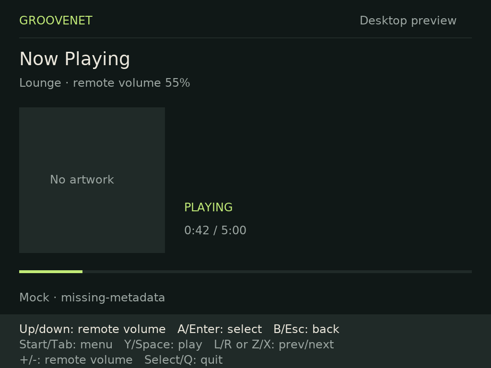

# Knulli application preview — #1107

Session: 2026-11-08 UTC / 2026-11-07 Pacific. Physical target is the same owner's
TrimUI Brick as #1095, running Knulli Scarab `2026/05/11 21:44` (Buildroot
2024.11, glibc 2.40, aarch64 Linux 4.9.191). Installed-card image checksum remains
unavailable. This record separates actual device checks from pending observations.

## Build and artifact

Run `just brick-package`. See [install/build instructions](../knulli/README.md).
The local copyable artifact is
`apps/groovenet-brick/build-knulli/groovenet-brick-knulli-preview.tar.gz` with a
SHA-256 sidecar. Build output is ignored rather than committed as a binary blob.
The archive includes its source/build manifest, binary/font hashes and font license.

Build baseline: Debian image
`sha256:734a72b3d6142a71993b4bc580ca01d8ca687f77a2c422d96a961d3376b179bc`,
ARM64, frozen Debian + Debian-security snapshot `20261107T000000Z`; GCC
`12.2.0-14+deb12u1`, `aarch64-linux-gnu`, CMake `3.25.1-1`, SDL2
`2.26.5+dfsg-1`, SDL_ttf `2.20.1+dfsg-2`, curl `7.88.1-10+deb12u15`, json-c
`0.16-2`, DejaVu font `2.37-6`. Complete package versions are inside `BUILD.txt`.
This is an experimental Debian ABI baseline, **not an official firmware SDK**.

Initial installed binary SHA-256:
`c54490510997fbb6dd14d67f7fa8bdec328385b934d0402b64cac1b33d6b211c`.
Initial archive SHA-256:
`cf1864dffd3c056ad1cdad6186dfe51abc722eefd3ad1188b57505fdf530c164`.
Final artifact hashes will be recorded after final verification/build.

## Device checks performed over USB ADB

- Installed the archive into `/userdata/roms/ports/`, with `Groovenet.sh` mode 755. No firmware/system libraries, autostart hooks, power service, network
  configuration or other Ports entries were changed.
- Provisioned a separate private config and public CA under
  `/userdata/system/configs/groovenet-brick/`. Requested 700/600 modes are not
  enforced by this card’s `fuseblk` userdata mount (synthetic 777); this limitation
  is documented rather than claiming permission isolation. Player key
  came from the repository's established private secret reference; it was never
  printed or packaged. The local transient credential copy was removed. Collection
  credential is independently optional and was omitted in this session.
- Server origin `https://groovenet.home.arpa`, with the previously tested public
  Caddy root explicitly supplied. TLS verification remains enabled. **Lounge** is
  the player's deliberately chosen test target; no agent playback writes sent.
- On-device `ldd` resolved every direct/transitive dependency, including
  SDL2_ttf, SDL2, curl, json-c, libstdc++, glibc and font/TLS dependencies. Loader
  `/lib/ld-linux-aarch64.so.1`. Runtime SDL2 `2.32.8`, SDL_ttf file `2.24.0`,
  json-c file `5.3.0`, curl `8.12.1`, OpenSSL `3.4.0` (firmware/prior probe).
- The application emits the prior probe's warning:
  `/usr/lib/libcurl.so.4: no version information available`. Resolution alone
  does not establish full ABI compatibility; this remains a release limitation.
- Read `/usr/share/emulationstation/es_input.cfg` and `sdl2-jstest --list`:
  actual Brick GUID `030000005e0400008e02000014010000`, 17 buttons, two axes,
  one hat. SDL defaults to an incorrect Xbox mapping (`a:b0`, with b0 actually
  Linux local-volume keycode 114). The app overrides it using Scarab's own A/B,
  X/Y, shoulders, Start/Select and D-pad definitions. No guessed L3/R3 mapping is
  used.
- The owner launched the real application and reported initial Aswitch observation
  and a nonfunctional D-pad. A 45-second `sdl2-jstest --test 0` capture during the
  owner's ordered physical presses established: Up/Down emit axis 1 −32768/+32767;
  Left/Right emit axis 0 −32768/+32767; neutral is −1. The advertised hat stays 0.
  A/B/X/Y emitted buttons 5/4/6/7, L/R 8/9, Start/Select 13/12, matching the
  firmware's button assignments. The preview was frozen during diagnostic input
  and terminated without draining queued inputs before replacement.
- Corrected the mapping to signed D-pad axes and added an SDL virtual-controller
  regression exercising each direction and return to neutral. The owner's retest
  still failed: inspecting **only SDL environment variables** in the real Ports
  process exposed `SDL_GAMECONTROLLERCONFIG` with the firmware's wrong hat mapping
  and swapped A/B/X/Y semantic positions. SDL environment mappings outrank normal
  `SDL_GameControllerAddMapping` calls. The device profile now overrides that hint
  at `SDL_HINT_OVERRIDE` priority **before SDL initialization**; a regression uses
  the conflicting inherited mapping and checks the effective SDL mapping. Installed
  that build and asked the owner to repeat navigation and select Lounge.

- Owner confirmed navigation works after the priority fix, then reported an exit
  after pause/play. The application log showed `Text has zero width`, not a kernel
  crash: an empty live metadata field reached SDL_ttf 2.24 during refresh. The
  shared renderer now skips empty strings; the missing-metadata fixture and
  pause/resume rendering regression cover it without relying on host SDL_ttf's
  empty-string behavior. Album artwork remains explicitly deferred to #1098.

- Owner reported the X+L/R chord skipped tracks instead of changing volume and
  requested Up/Down volume. Removed the modifier/chord: Up/Down now changes server
  volume on Now Playing, and still navigates menus/lists. L/R remains skip. Tests
  check both contexts and the persistent hints reflect the current screen.

- Owner then reported a brief disconnected/no-playback flash on volume changes,
  confirming it recovered after a moment. The shared client now distinguishes
  command/wake refresh from a real disconnect, retaining the enriched last known
  metadata with an UPDATING indicator. Controls remain disabled until a fresh SSE
  snapshot; values are not predicted and writes are not replayed. The TLS fixture
  holds a command until retained metadata and blocked controls are verified, then
  exercises conflict/lost-response recovery. Actual errors clear the refresh flag.

## Physical smoke results

Owner confirmed navigation works after the mapping-priority correction. Pause/play
then exposed the empty-metadata renderer exit described above. The fixed build
passed an **actual on-device** two-frame Mali rendering test with the bundled font,
`--scenario missing-metadata --actions up,down,play,play`, exit 0 and a 1024×768 BMP capture.
The firmware does not include SDL's dummy video driver; that attempted run failed
visibly before using the real display driver. This is a mock-data renderer check
on the real runtime, not a claim of successful live transport.

After installing the Up/Down volume build, the owner replied “yeah seems working”
to a retest request covering Lounge selection, Now Playing volume, Y pause/resume,
short Power/wake, Select/quit and continued server playback. This is an informal
operator smoke result, not measured timings or independent playback telemetry.
No further crash was reported. L/R was physically mapped and the owner previously
observed skips during the rejected volume chord.

The owner then confirmed both the retained metadata during volume refresh and
external-controller track-change freshness (“yeah, both work”).

Pending explicit observations: upright/full-screen display confirmation and local
device-volume isolation.
No desktop test is substituted for these.
Follow the exact [physical smoke steps](../knulli/README.md#physical-smoke-test-owner-observations-required).

The #1095 probe previously demonstrated short real suspend and display restoration;
those observations do not certify this application. Long unplugged suspend,
Wi-Fi/AP recovery, repeated wake-to-fresh timing, battery qualification and a
pinned Knulli SDK remain in #1102. Do not restart ConnMan or change firmware policy
as part of the preview. No full reliability or stable release claim is made.

## Automated validation

- `just brick-test`: three CTest suites passed (native behavior/resource failures,
  real loopback TLS/SSE fixture, isolated Ports launcher).
- `just brick-coverage`: 99.38% native lines, 96.35% branches; changed desktop/input
  implementation, renderer and platform header 100% lines/branches. All new executable native
  lines covered, including mapping failure, contextual volume and wake-gap recovery.
  Diff-to-LCOV inspection found all 65 changed executable native lines covered
  with no partial branches on changed lines.
- `BRICK_ARCHIVE=... python3 apps/groovenet-brick/tests/test_package.py`: launcher
  behavior plus actual archive allowlist, AArch64 ELF, executable modes,
  placeholder-only config, font license and binary/font hashes passed.
- `just lint-all`: repository-wide pre-commit hooks passed; repeated after final edits.
