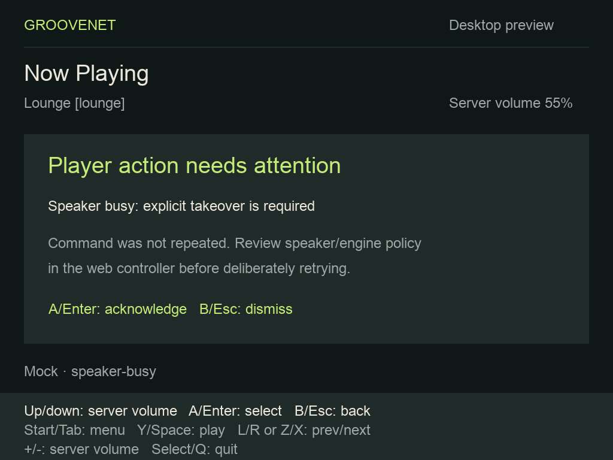

# Selected-player Now Playing — #1098

Validation on macOS, 2026-11-07. This is the native application on a desktop;
physical speaker playback and firmware lifecycle qualification remain in #1102.

## Automated validation

- `just brick-test`: all three CTest suites pass (package, TLS network and
  state/input/SDL rendering).
- `just brick-coverage`: all suites pass; application line coverage 99.30%,
  branch coverage 95.30%. The image decoder has 100% line coverage, including
  PNG/JPEG success, malformed/truncated input and both dimension limits.
- The TLS fixture proves no automatic first-player selection, ID persistence
  across restart, server scoping, a removed selection without fallback, a
  visible save failure, authoritative command reconciliation, acknowledgment
  before further input and bounded repeated commands. A deliberately delayed
  metadata response is superseded by a new track and cannot replace it.
- Artwork tests verify same-origin collection authorization, no player
  authorization on image requests, no credential on external image hosts,
  refused credential-bearing URLs/downgrade and query-bearing cover URLs.
  SDL faults exercise both texture allocation and upload fallback.
- Focused clock tests check fractional timing, authoritative reconciliation,
  stale timing cutoff, duration clamping, unknown timing, paused/disconnected/
  refreshing/loading/unavailable states and retention through metadata updates.
- `just lint-all`: repository pre-commit hooks pass.

## Development-player smoke with a second controller

Reproduce from the repository root:

```sh
just build-packages
just brick-build
mise exec -- node apps/groovenet-brick/tests/development_smoke.mjs
```

The harness provisions an isolated `postgres:17-alpine` container, applies the
production player migrations and starts the production Postgres store, player
manager and HTTP/SSE server. A small HTTP proxy supplies the app's `/api` path
shape and track metadata. The audio backend is a silent deterministic event
emitter; it never connects to speakers or OwnTone. Temporary credentials and
selection files are generated locally and removed with the container.

Observed pass:

1. The Brick explicitly selects `brick-smoke` without changing its existing
   two-entry queue or starting another session.
2. A second REST controller pauses; the Brick observes the paused state over
   SSE. The Brick resumes through its play/pause button action.
3. Brick server-volume-up reaches 55, and Next advances to entry two.
4. The second controller renames the player to a non-ASCII name and sets volume
   to 33; the Brick observes both changes.
5. Wake refresh obtains authoritative state. A new Brick adapter opens directly
   into the remembered player's second entry.
6. Disconnect leaves the server playing with volume 33 and both queue entries.
   The harness checks the retained PostgreSQL state before cleanup.

This validates real player contracts, persistence and concurrent control, with
no audible-output or physical-device claim.

## Desktop visual check

The `speaker-busy` mock scenario displays the same acknowledgment panel used
for live speaker/engine conflicts. Select or Back dismisses it without sending a
command or approving takeover. Transport/volume input remains blocked until
then. Speaker or engine policy changes require the web controller.



Existing desktop scenarios also exercise missing artwork/metadata, long UTF-8
text, unknown duration, disconnection and refresh. The `artwork` scenario tests
the decoded RGBA texture path without network timing.
