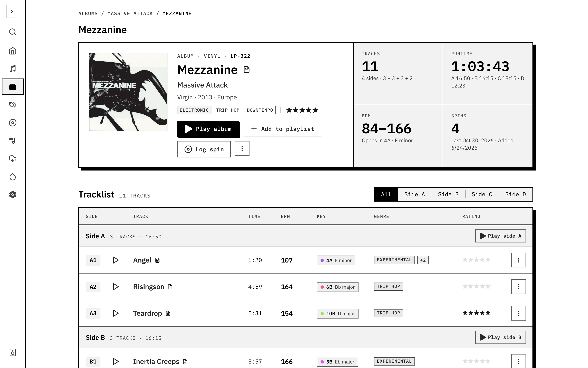
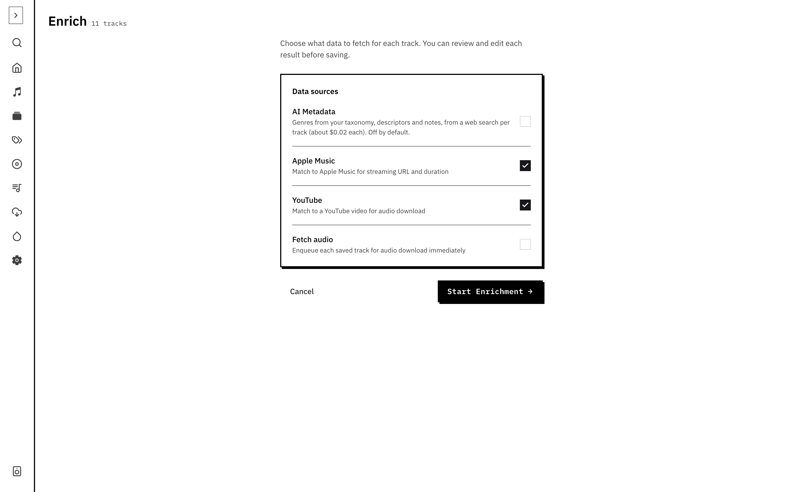
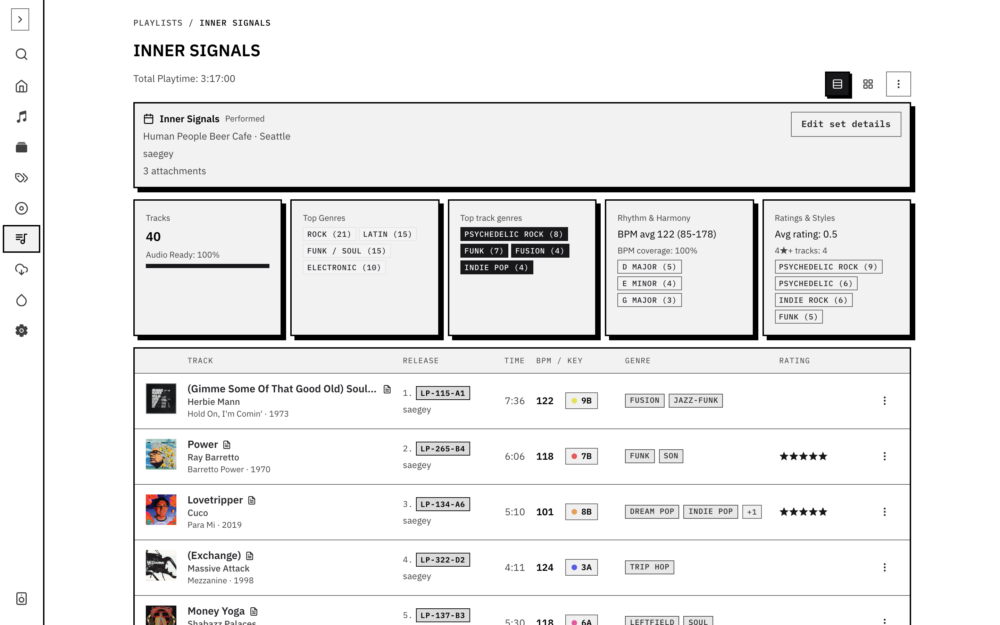
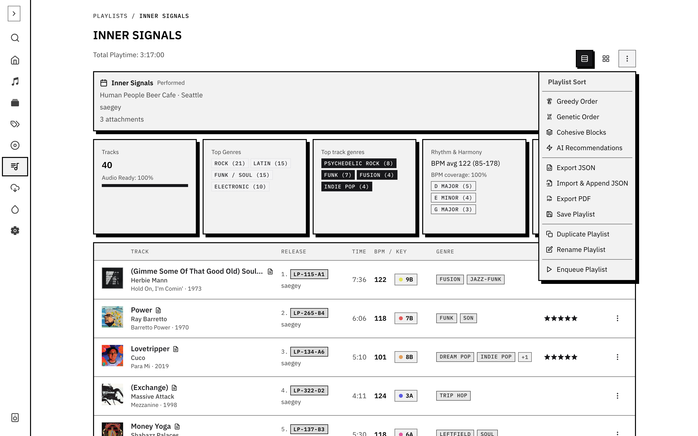
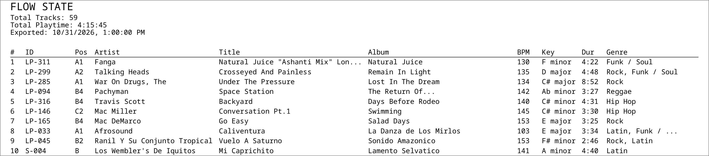
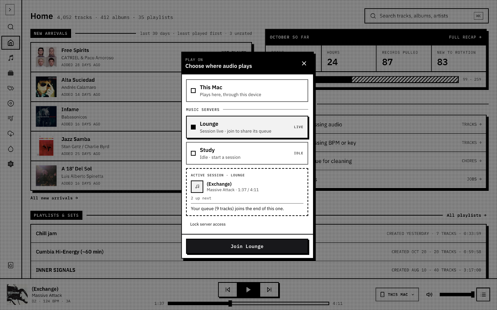
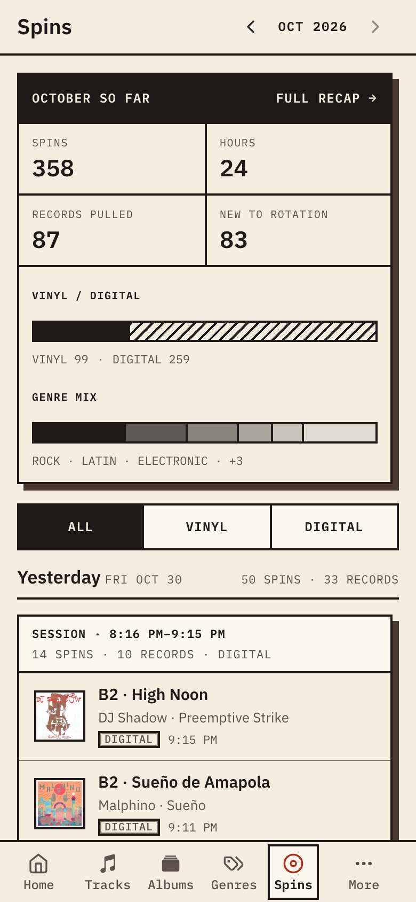

This page follows a single record through GrooveNet, from the shelf to the booth and back. Each step says what happens and links to the page that covers it properly.

<ol class="flow" aria-label="The journey of a record through GrooveNet">
  <li><a href="#1-import-it">Import</a>Discogs to albums and tracks</li>
  <li><a href="#2-enrich-it-and-fetch-the-audio">Enrich</a>match recordings, fetch audio</li>
  <li><a href="#3-let-groovenet-listen">Analyse</a>BPM, key, mood, fingerprints</li>
  <li><a href="#4-build-a-set">Build a set</a>search, playlist, order</li>
  <li><a href="#5-pull-the-records">Pull it</a>PDF set sheet</li>
  <li><a href="#6-play-it">Play it</a>server players, spins, set recordings</li>
  <li><a href="#7-look-back">Look back</a>spins and monthly recap</li>
</ol>

Everything is stored on your own server. The steps run in order for a new record, but you can come back to any of them: add audio later, re-order a set, or review last month.

## 1. Import it

Say the record is on your Discogs shelf. Set your Discogs credentials, then use **Settings → Libraries → Sync default library**. GrooveNet pulls in each release as an album with its tracklist, and the import can cover your whole collection or one folder.

Open **Albums** to see the record and **Tracks** to search its tracks. What you have at this point is Discogs data: titles, artists, genres and styles. There is no audio, BPM or key yet.

Read more: [Import from Discogs](/docs/getting-started/discogs/) and [Albums](/docs/using/albums/).

## 2. Enrich it and fetch the audio

Discogs doesn't know where to hear a track. The **Enrich** wizard walks through tracks with missing metadata, and for each one you check the artist, title and recording, then choose an Apple Music or YouTube match. That match is a link, not a file.

To get a file, queue a download for the track, or use **Download missing audio** on the album. GrooveNet downloads it in the background, and you can watch progress under **Jobs**. You can also upload a file you own. A track with audio is a track you can play, analyse and recognise later.

Read more: [Enrichment](/docs/using/enrichment/) and [Downloads and local audio](/docs/using/downloads/).

## 3. Let GrooveNet listen

Once a track has audio, GrooveNet measures it. BPM, key, danceability and mood come from the audio itself, not from Discogs or a streaming service. BPM and key carry a confidence, and anything unsure is flagged so you can listen and correct it.

The same measurements power audio-vibe similarity, which finds tracks that feel alike to play. For searching by describing a sound, GrooveNet also builds embeddings. To track what you play, you build a fingerprint index from the same audio, so your records can be recognised when they spin.

Read more: [Audio analysis](/docs/using/analysis/), [Finding similar tracks](/docs/using/similar-tracks/) and [Fingerprint index](/docs/vinyl-tracking/fingerprint-index/).

This step has no screenshot: analysis shows up as values on track cards and edit pages, and the docs have no capture of it yet.

## 4. Build a set

Now the record is ready to be used. Search **Tracks** by words, by a described sound, or by genre, and use **Similar** to find what mixes with what you already have. Add tracks to a playlist and drag them into order.

The playlist's actions menu offers **Greedy order**, **Genetic order** and **Cohesive blocks**, which reorder the set around BPM and key transitions. They're a starting point. Check the BPM curve and move entries by hand.

Read more: [Search and filters](/docs/using/search/), [Genres](/docs/using/genres/), [Finding similar tracks](/docs/using/similar-tracks/) and [Playlists and the optimiser](/docs/using/playlists/).

## 5. Pull the records

Choose **Export PDF** from the playlist's actions menu for a landscape set sheet. Each row has the album's library identifier (**ID**) and the track's position on the record (**Pos**, such as `A1`), so you can find the record on the shelf and the right track on it.

Read more: [Print a set sheet](/docs/using/playlists/#print-a-set-sheet).

## 6. Play it

You can play a set from a **music server**, a named player that keeps its queue when your browser closes. **Play on** chooses where audio plays. This is for files on the server; the vinyl on your deck is a separate path.

For records you play on a turntable, a listener connected to your deck sends short audio windows to GrooveNet, which matches them against the fingerprint index and logs each play as a spin. For a whole recorded set, `groovenet sets derive` turns the recording into a timestamped tracklist and compares it with the playlist you planned, marking what was played as planned, swapped, added, skipped or out of order. You can then correct the playlist. Set recordings are command-line only for now; the web app has no screen for them.

Read more: [Server players and Play on](/docs/using/server-players/), [Listener setup](/docs/vinyl-tracking/) and [Set recordings](/docs/vinyl-tracking/set-recordings/).

## 7. Look back

**Spins** groups detections into plays, so you can see what you played and when. Each month has a recap: spins, hours, records pulled, what was new to rotation, your genre mix, top records, tracks and artists, when you listen and the spread of tempos. **Home** shows the month at a glance.

Read more: [Detections and spins](/docs/vinyl-tracking/spins/) and [Home](/docs/using/home/).
