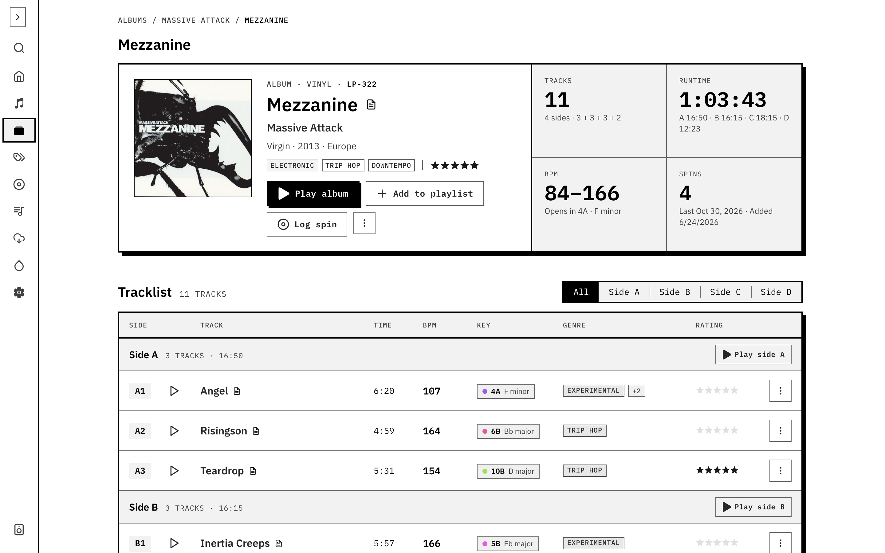

Open **Albums** to browse the collection as records. Search for a title or artist, use the sort control, and open **Filters** for genre or missing library identifier, local cover and audio.

Open a record to see its tracklist and release details. Add a library identifier to locate it on your shelves. Rate it or leave notes while the record is in front of you.

Use the album's download action to queue missing tracks. Check their streaming matches first if downloads fail or bring back the wrong recording. Physical copies and their cleaning history live in [Copies & care](/docs/using/record-care/).

