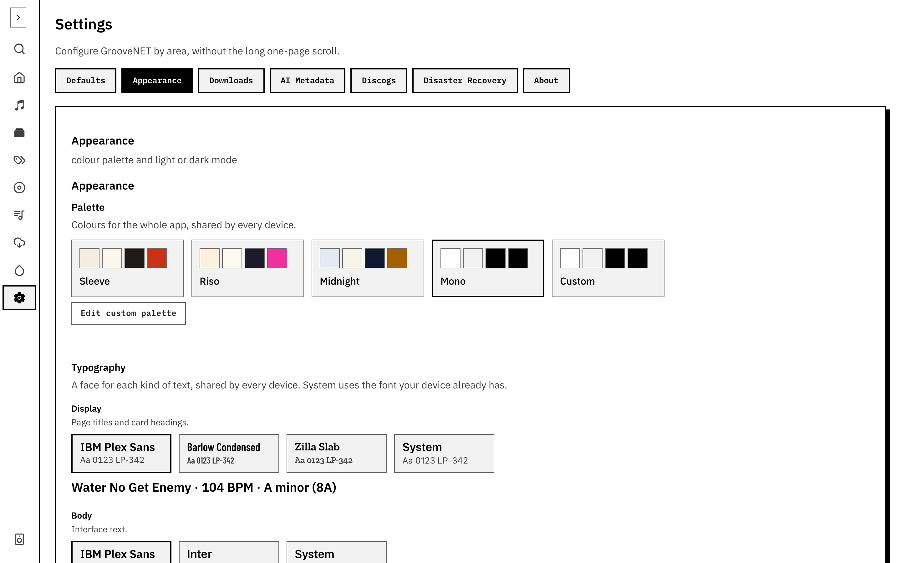
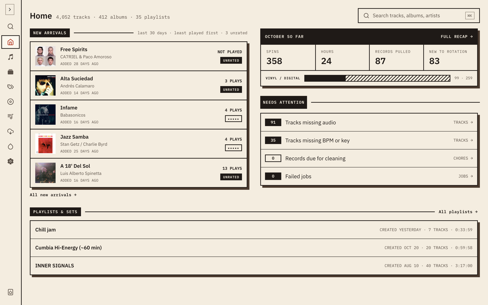
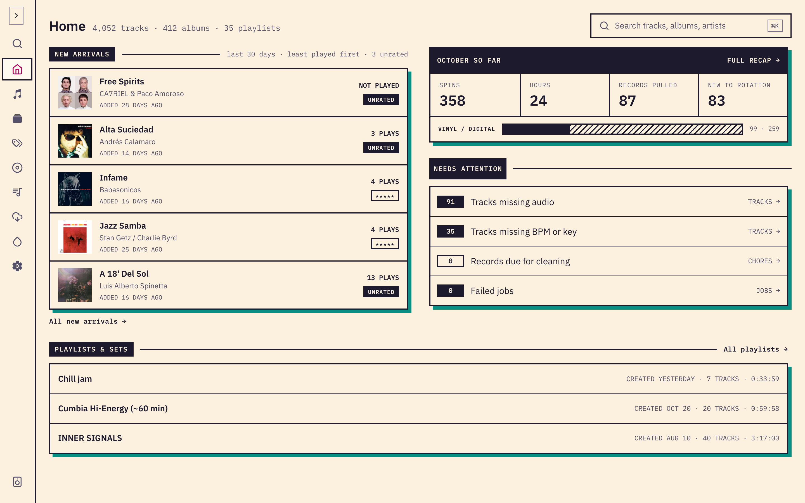
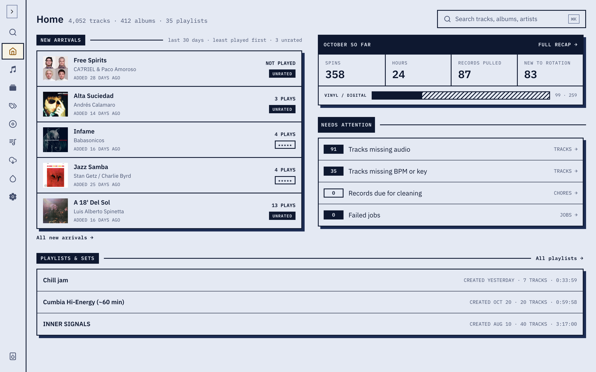

Open **Settings → Appearance** to change how GrooveNet looks. There are three choices, and they are saved in different places:

- The **palette** and the **typefaces** are shared by every device that uses your server.
- **Light, dark or system** is remembered on the device you set it on, so a phone and a laptop can differ.

## Palette

A palette is the set of colours for the whole app. Each card shows four swatches (ground, surface, ink and accent) for the mode you're in, and the selected one is outlined. The change applies as soon as you pick it.

| Palette      | In short                                              |
| ------------ | ----------------------------------------------------- |
| **Sleeve**   | The default: warm paper tones with a red accent.      |
| **Riso**     | Cream and deep ink with a hot-pink accent.            |
| **Midnight** | Cool blue-grey with an amber accent.                  |
| **Mono**     | Greys only, black on white at the AAA contrast level. |
| **Custom**   | Your own, if you've made one.                         |

### Make your own

Choose **Create custom palette**, then **Start from** a preset. You set five colours for light mode and five for dark: the page background, panels and menus, text and outlines, the accent used for primary actions and selection, and the hard offset shadow. The rest, and the status colours, come from the preset you started from.

The editor shows a live preview, and beside each colour the contrast it makes against what it sits on, marked **Pass** or **Fail** against the level it needs. Fix any failures before saving, so text stays readable. Save it and it becomes the selected palette. **Edit custom palette** reopens it, and you can delete it from the editor. Deleting returns the app to a preset.

## Typefaces

Typography has one choice for each kind of text:

- **Display**, for page titles and card headings.
- **Body**, for interface text.
- **Labels**, for buttons, tags, navigation and IDs such as `LP-342`.

Each role offers a few faces, with a preview in the face. **System** uses the font your device already has, which loads fastest and is the safest choice if a custom face looks wrong.

## Light and dark

**Mode** is **Light**, **Dark** or **System**. System follows the operating system, so the app switches with it. This is remembered on the current device only. The palette you chose has both a light and a dark version.
