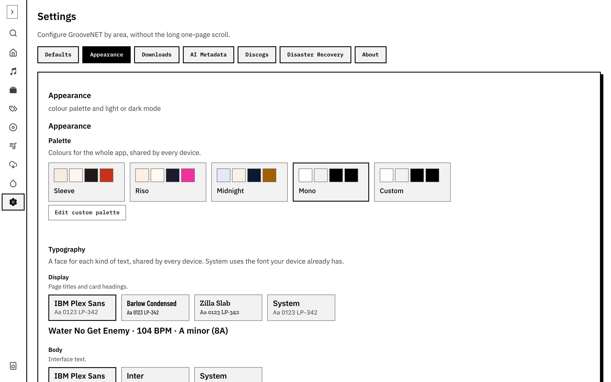
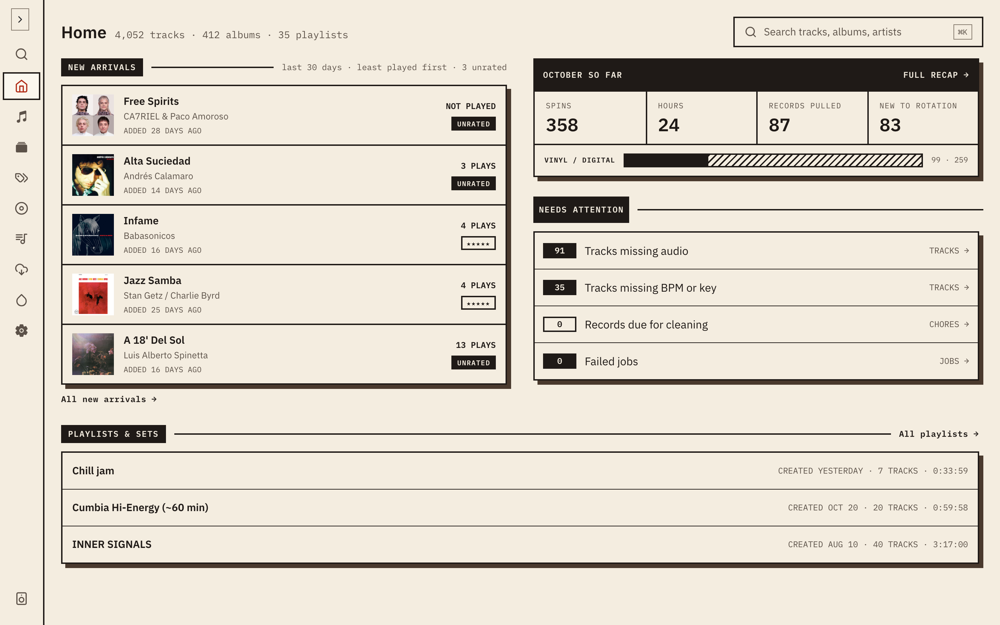
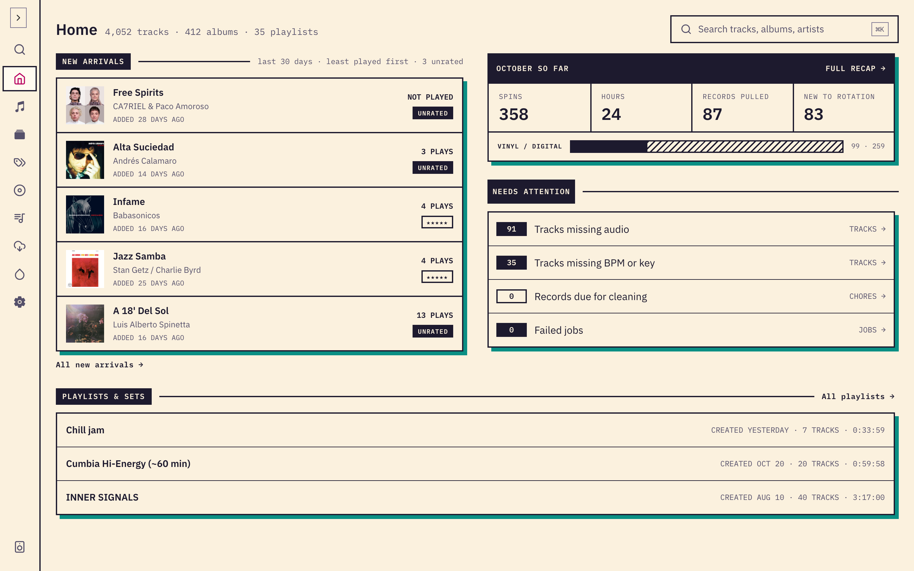
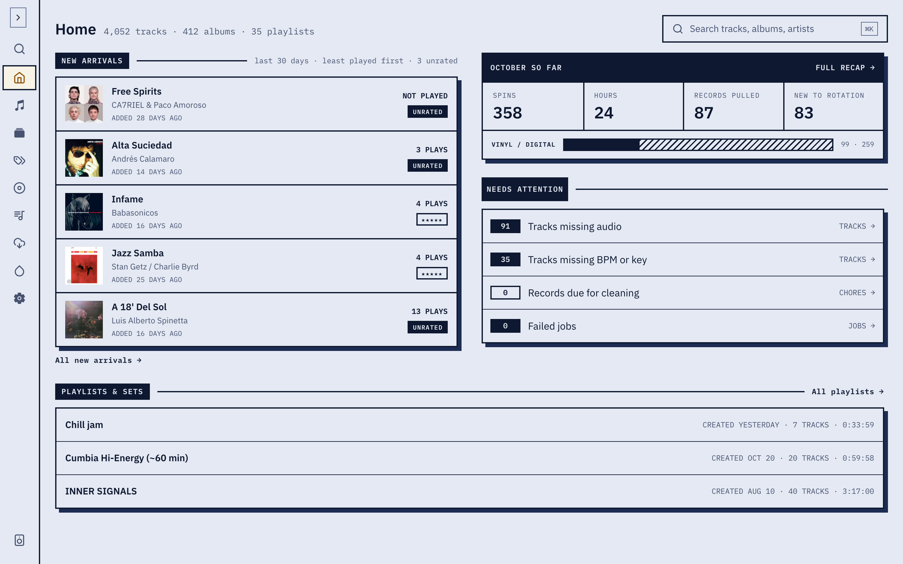

Open **Settings → Appearance** to change how GrooveNet looks. Each part is labelled with where it applies:

- The **palette**, **corners** and **typefaces** are shared by every device that uses your server (labelled _Every device_).
- **Light, dark or system** is remembered on the device you set it on, so a phone and a laptop can differ (labelled _This device_).

## Palette

A palette is the set of colours for the whole app. Each card shows four swatches (ground, surface, ink and accent) for the mode you're in, and the selected one is outlined. The change applies as soon as you pick it.

| Palette      | In short                                              |
| ------------ | ----------------------------------------------------- |
| **Sleeve**   | The default: warm paper tones with a red accent.      |
| **Riso**     | Cream and deep ink with a hot-pink accent.            |
| **Midnight** | Cool blue-grey with an amber accent.                  |
| **Mono**     | Greys only, black on white at the AAA contrast level. |
| **Custom**   | Your own, if you've made one.                         |

### Make your own

Choose **Create custom palette**, then **Start from** a preset. You set six colours for light mode and six for dark: the page background, panels and menus, **Ink** (text), **Outline** (the strong lines round buttons, cards, inputs and chips), the accent used for primary actions and selection, and the hard offset shadow. Outline starts out the same as Ink, as in every preset, so set it to something else to give cream text a darker or tinted outline. A palette saved before Outline existed keeps looking the same: its outline is its ink. The rest, and the status colours, come from the preset you started from.

The editor shows a live preview, and beside each colour the contrast it makes against what it sits on, marked **Pass** or **Fail** against the level it needs: 4.5:1 for text, 3:1 for outlines. Fix any failures before saving, so text stays readable. Save it and it becomes the selected palette. **Edit custom palette** reopens it, and you can delete it from the editor. Deleting returns the app to a preset.

## Corners

**Square** is the default: sharp corners everywhere. **Rounded** softens buttons, inputs, cards, dialogs, menus, tags and the navigation to a 6px radius; round things such as avatars stay round, and the hard shadows follow the new shape. A live preview beside the choice shows a track row, a tag, a search field and a button. The change applies as soon as you pick it and is shared by every device.

## Typefaces

Typography has one choice for each kind of text:

- **Display**, for page titles and card headings.
- **Body**, for interface text.
- **Labels**, for buttons, tags, navigation and IDs such as `LP-342`.

Each role is one dropdown. Open it and every option is shown in its own face, grouped as **Sans**, **Mono**, **Slab** and **System**; the closed dropdown shows your current choice in its face, and a preview line underneath (page titles, interface text, `LP-342 · BUTTON`) shows the result without opening anything. **System** uses the font your device already has, which loads fastest and is the safest choice if a custom face looks wrong. **Maple Mono** is offered for Body and Labels.

Like the palette, a font you choose applies to this device. **Use as the default for everyone** saves it for every device.

### A font installed on this device

The last option in each dropdown is **Font on this device…**. Use it for a font you have installed that GrooveNet doesn't ship, such as Berkeley Mono.

- In Chrome, Edge and other Chromium browsers, **Choose from installed fonts** asks for permission to read your font list, then lets you search it. In other browsers, or if you decline, type the family name instead.
- A preview shows the font as you type. If the name doesn't look installed on this device, you get a warning and text uses the default sans-serif (or monospace, for Labels) font instead. You can still use the name.
- Names may use letters, numbers, spaces, `-` and `_`, up to 64 characters.

A font installed on this device applies **only here**. It is never saved as the default, and **Use as the default for everyone** leaves it out, so your other devices and other profiles keep the saved default. If you later uninstall the font, the same fallback takes over and the layout holds. **Reset** returns the role to the default.

## Light and dark

**Light or dark** is **Light**, **Dark** or **System**. System follows this device's setting, so the app switches with it. This is remembered on the current device only. The palette you chose has both a light and a dark version.
