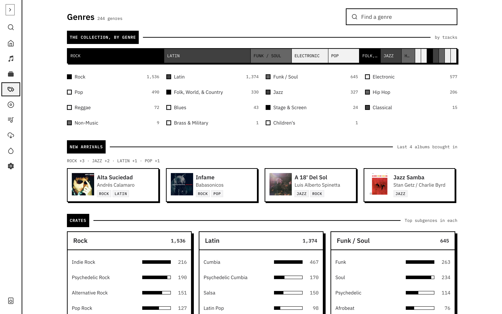
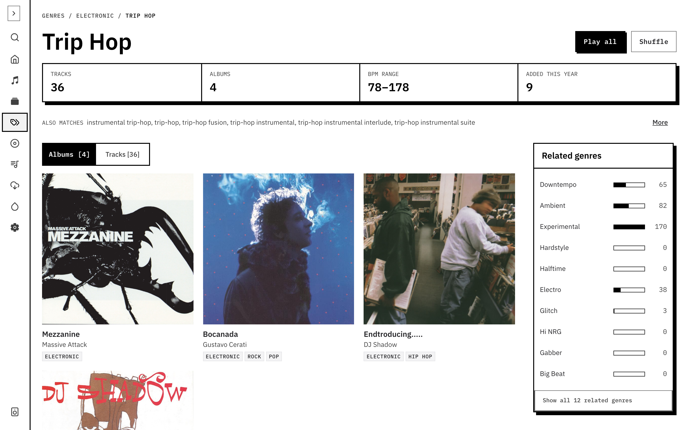

GrooveNet keeps a **genre taxonomy**: a tree of genres and subgenres built from the Discogs genre and style lists, with your own additions. Albums are tied to it through their Discogs genres and styles, and tracks through the genres you or the reconciliation tools give them. The taxonomy is what the **Genre** filter on [Tracks and Albums](/docs/using/search/) searches, and why choosing a genre includes its subgenres.

## Browse

Open **Genres** to see the collection by genre.

- **The collection, by genre** is a bar and legend of your top-level genres with their track counts. Select one to open its page.
- **New arrivals** summarises the genres of your most recently added albums.
- **Crates** lists the top subgenres in each genre. Open the full list when a genre has more than fit.
- **Find a genre** filters the whole taxonomy by name.



## A genre's page

Each genre has a page with its tracks and albums. Open it from the Genres page, or from a parent genre's subgenre list.

- A strip of counts: tracks, albums, BPM range and tracks added this year.
- **Play all** and **Shuffle** play the genre's playable tracks.
- **Albums** and **Tracks** switch what the list shows. A genre page also lists its subgenres, with the path to it in the breadcrumb.
- **Also matches** lists the aliases that map onto the genre. A genre you added yourself carries a **Custom** badge.
- A BPM spread for the genre, so you can see where it sits.



### Related genres

Beside the list, **Related genres** shows genres that sit near this one: its siblings, parent and children in the taxonomy, and genres that often turn up on the same albums in your collection. Use it to widen a crate: when you've run out of one genre, the neighbours are the next place to dig.

A genre with only a few albums reads **Neighbouring crates** instead, with a **Build this crate** note pointing you to those neighbours. It's a prompt to go and find more records, not a tool that builds one.

To search across related genres, turn on **Include similar** in the Tracks filters. It adds the top related genres to your genre filter as removable chips. From a terminal or an assistant, use `groovenet genres similar <slug>` or the `get_similar_genres` tool. See [CLI](/docs/cli/#genres-similar) and [MCP](/docs/mcp/#genre-discovery).

## Mapping your own tags

Free-text tags in the `local_tags` field are your own labels. Reconciliation maps them onto the taxonomy so a track tagged "cumbia" in your own words ends up under Cumbia. It is run from the CLI, and nothing changes until you apply it.

```bash
groovenet genres reconcile        # propose a mapping for every distinct tag
groovenet genres review           # accept, remap or drop the proposals
groovenet genres apply            # write the accepted ones to your tracks
groovenet genres coverage         # how much of the backlog is done
```

1. **Reconcile** looks at every distinct tag value. Tags that exactly match a genre name or alias are proposed first; the rest go to the AI model you've configured, unless you pass `--no-ai`. Each proposal is a mapping to one or more genres, a new genre, a descriptor (a mood or description rather than a genre), or a drop.
2. **Review** groups the proposals by what they would do, biggest group first, so the first few minutes cover most tracks. One key decides a whole group: `a` accept, `x` split, `r` remap, `n` new genre, `d` descriptor, `k` drop, `s` skip, `u` undo, `q` quit. Each decision is saved as you make it, so you can quit and come back. `--auto-accept-exact` accepts the exact matches up front.
3. **Apply** writes accepted and edited proposals to the tracks' genres, descriptors and aliases, after one more confirmation (`--yes` skips it).

`groovenet genres proposals` lists them without reviewing. Discogs' own genres and styles are never edited; reconciliation only adds your tags' meaning on top.

By default these commands cover your default library; pass `--all-friends` for every collection.
