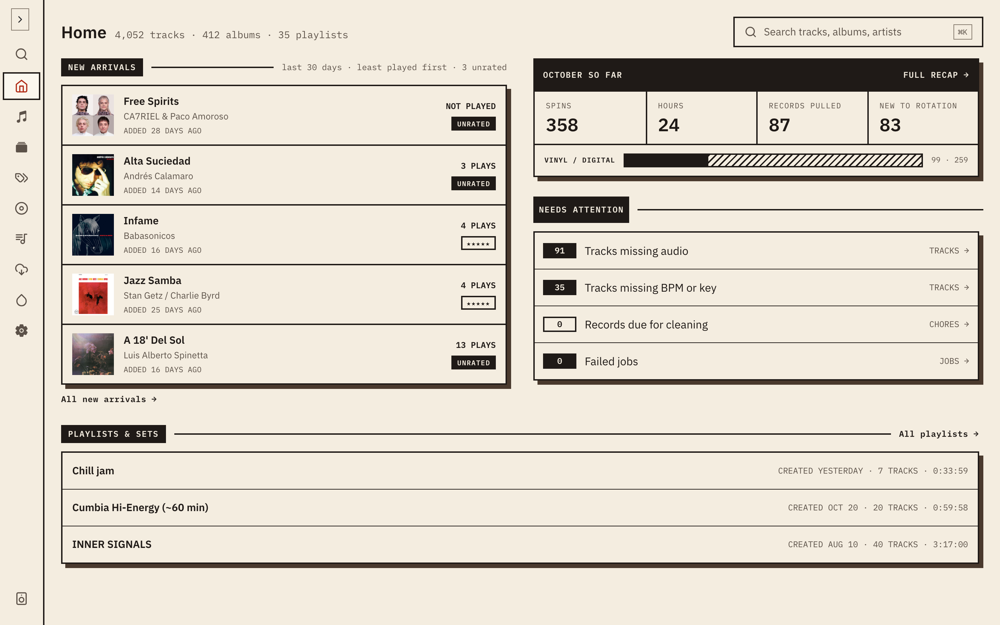

**Home** is the first page you see. It pulls together what's playing, what's new and what needs a look. Each section loads and fails on its own, so one error doesn't blank the rest.

The header shows the size of your collection, as counts of tracks, albums and playlists, and a **Search** button that opens the command palette.

## Now playing

A card for what is playing right now. It shows a [music server](/docs/using/server-players/) that is playing, and selecting it opens Now playing. It never shows audio playing in this browser.

When no server is playing, it shows the most recent record the [vinyl listener](/docs/vinyl-tracking/) recognised, for as long as that detection is still fresh. When there's neither, the card isn't shown.

## New arrivals

Albums added to your collection in the last 30 days, with the least-played first, so the records you haven't got to yet are at the top. Each shows its play count (or **NOT PLAYED**) and a rating, or **UNRATED**. On a phone the cards scroll sideways. **Browse albums** opens the full list.

## This month

The month's [recap](/docs/vinyl-tracking/spins/#monthly-recap) so far: spins, hours, records pulled and new to rotation, and from tablet width up, the split between vinyl and digital. Select the header to open the full recap.

## Needs attention

Four counts, each linking to the list behind it:

- **Tracks missing audio**: opens Tracks filtered to them. See [Downloads](/docs/using/downloads/).
- **Tracks missing BPM or key**: opens Tracks filtered to them. See [Audio analysis](/docs/using/analysis/).
- **Records due for cleaning**: opens Chores, filtered to overdue. See [Record care](/docs/using/record-care/).
- **Failed jobs**: opens Jobs, filtered to failed.

If every count is zero, the section says everything is clear. A count that couldn't be loaded is shown as unavailable rather than zero.

## Playlists and sets

Your most recent draft set, highlighted, then your three most recent playlists, each with its track count, length and when it was created. **All playlists** opens the full list. With no playlists yet, it links to Tracks so you can start one. See [Playlists](/docs/using/playlists/).
