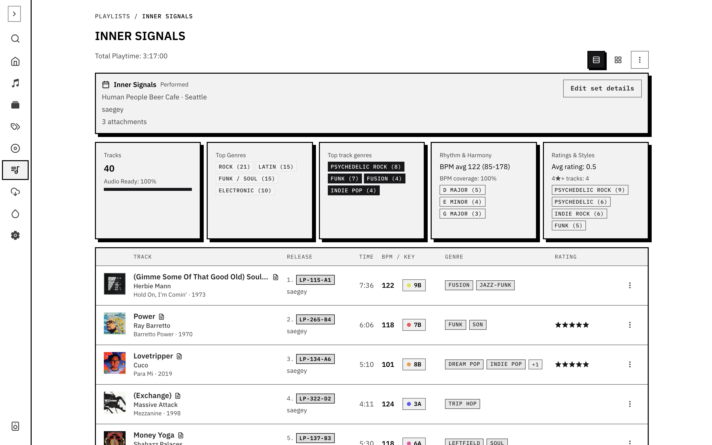
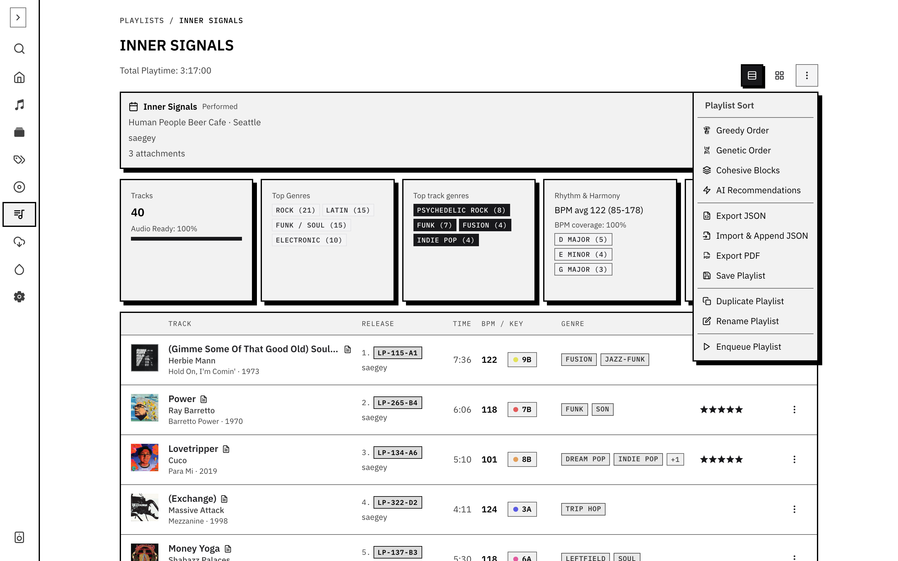

Add tracks to a playlist from the track actions, then open **Playlists** and select it. Drag entries to set the order. Save the playlist when the sequence works.

The actions menu offers **Greedy order**, **Genetic order** and **Cohesive blocks**. These reorder selected material around musical transitions. Greedy order is a quick pass; genetic order searches for a sequence; cohesive blocks keeps related material together. The server-backed genetic and cohesive-blocks modes need BPM and audio-vibe embeddings. Enrich and analyse missing tracks first.

Review the BPM curve, keys, duration and repeated records after sorting. An optimiser cannot know which transition you want to ride or cut. Move entries by hand and save the result.

Use export/import actions when moving a set between tools. **Enqueue** sends it to playback. To check a set from a terminal, use `groovenet playlists check <id>`; see the [CLI guide](/docs/cli/).

