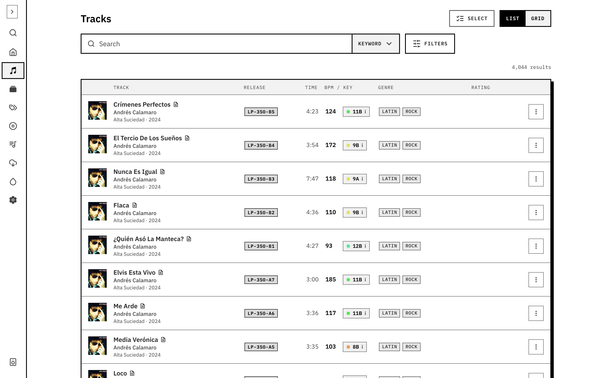
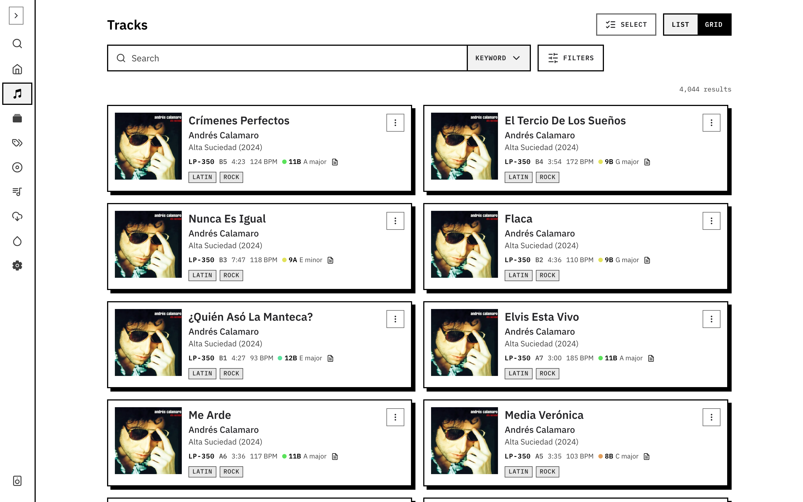

Open **Tracks** and enter a title, artist, album or tag. Leave the query empty to browse by filters alone.

Use the search mode control to choose word matching, semantic search or hybrid search. Semantic search matches a description of the sound; hybrid combines it with word matches. Semantic features need embeddings for the collection.

Open **Filters** to narrow the list by genre, BPM, key, rating or missing metadata. Genre selections include their subgenres. Active filter chips show what is applied; remove a chip to widen the search.

On a phone, open **Search options** for search mode and filters, then **Show results** to return to the list. Open a track for its metadata, streaming links and playlist usage.

