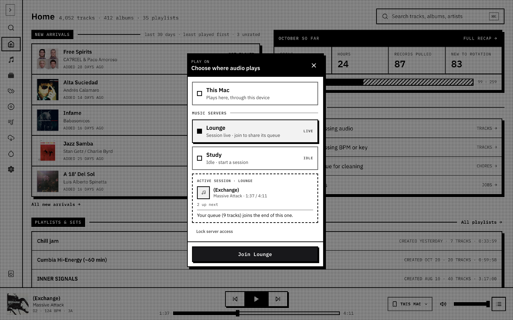
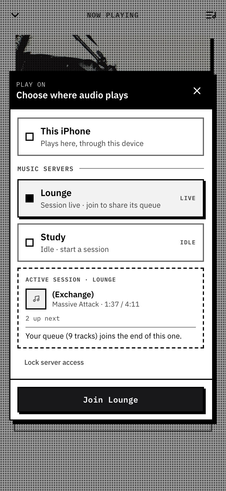

A **music server** is a named player that owns its queue and its playback. Your browser, or any other, connects to it as a remote. Close the tab and the music keeps playing; the queue stays on the server.

## Play on

**Play on** chooses where audio plays. Open it from the output button in the desktop player bar, from the **Play on** row in Now playing on a phone, or from **Playback** in the navigation. The picker lists this device, then every music server under **MUSIC SERVERS**. A server that is playing, paused or loading reads **LIVE**; any other is **IDLE**.

Choosing a row only previews it. The button at the bottom confirms. If the picker asks for a household passphrase first, enter the one your operator set for web access.

## Join, and hand off

- **Join a server** and the tracks left in your local queue, from the current one onward, are added to the end of the server's queue. If the server was idle, the first of them starts. Your device stops playing and its own queue is cleared, so there's one queue in view.
- **Play here** switches back to this device. The server isn't stopped: it keeps playing its queue.

Closing the picker, reloading the page or losing the connection never pauses or clears a server.

## The shared queue

Once you're joined, the player, Now playing and the queue are the same screens as local playback, reading the server's queue. The queue shows a **SERVER SESSION** strip with the server's name, "shared queue" and **Play here**. Anyone connected can add, remove and reorder entries, and the last change wins. Play now replaces the server's queue; Enqueue adds to the end.

## AirPlay

A server plays through its own engine, which is [OwnTone](https://github.com/Public-Vinyl-Radio/groovenet/blob/main/packages/groovenet-player/OWNTONE.md), so a server can send audio to an AirPlay speaker without your device. Setting up players is an operator task: see [server players](https://github.com/Public-Vinyl-Radio/groovenet/blob/main/packages/groovenet-player/SERVER_PLAYERS.md) for the Compose setup and [OwnTone](https://github.com/Public-Vinyl-Radio/groovenet/blob/main/packages/groovenet-player/OWNTONE.md) for AirPlay discovery and pairing.

Where your browser supports it, **AirPlay…** under **From this device** instead sends this device's own audio to an AirPlay speaker.
