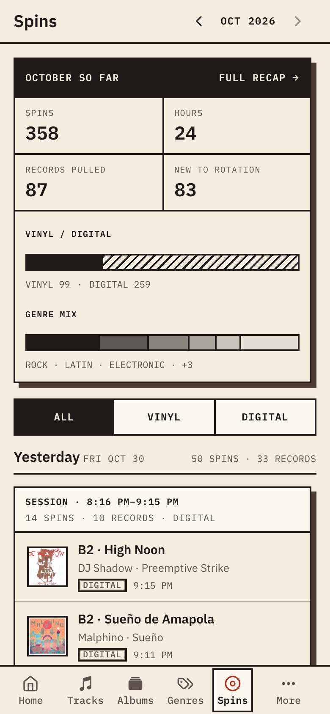

Open **Vinyl** to inspect the ingest pipeline. Check that chunks arrive, the worker processes them and the reference index is populated. A processed chunk without a match is normal between tracks; a whole session without matches needs investigation.

```bash
groovenet vinyl status
groovenet vinyl detections
```

Check the reported level during silence and music before setting `FINGERPRINT_MIN_LEVEL_DBFS`. A floor between them avoids matching idle-chain hiss. Raising `FINGERPRINT_MAX_BER` allows weaker matches and can create false plays.

Open **Spins** to review listening history. Detections are grouped into plays rather than counting every overlapping window as another spin.

## Monthly recap

Each month on **Spins** has a recap, at `/spins/recap/<YYYY-MM>` (for example `/spins/recap/2026-10`). Open it from the recap strip on **Spins**, or from the month card on [Home](/docs/using/home/). Use the previous and next month buttons to move between months. The current month reads "so far"; a month that hasn't started yet doesn't exist.

The recap shows:

- **Spins**, **hours**, **records pulled** and **new to rotation**, each compared with the month before. Records pulled counts distinct records played. New to rotation counts records played for the first time ever that month. Hours is marked approximate (≈) when some tracks have no known duration.
- **Vinyl / digital**: the split of the month, and week by week.
- **Genre mix** by top-level genre, against the month before. Select a genre to open its [page](/docs/using/genres/).
- **Top lists** of records, tracks and artists.
- **When you listen**: a grid of weekday against two-hour blocks, shaded by spins.
- **BPM spread** of the month's tempos, with the median, from 80 to 200 BPM. Spins whose tracks have no BPM yet are left out.



## Recorded sets

For a recorded set, `groovenet sets derive set.mp3 --playlist <id>` derives a tracklist against the same reference index and compares it with your plan. See [Set recordings](/docs/vinyl-tracking/set-recordings/).
