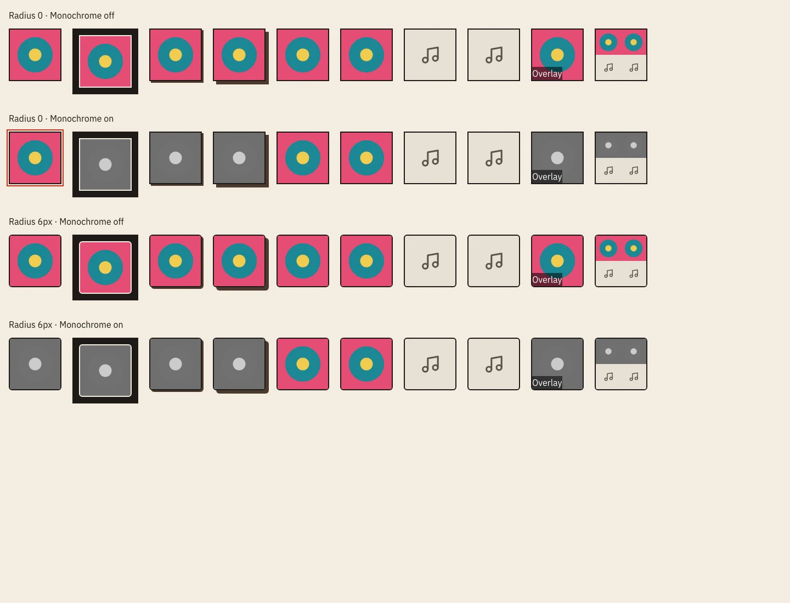

# Shared cover treatment (#978)

`my-collection-search/src/components/Cover.tsx` owns album artwork, missing and
broken-art fallback, sizing, overlays, and the inverse, stacked, shadow and inspect
treatments. The existing `player/Artwork` export forwards to it for compatibility.
Set flyers remain portrait images, separate from square album covers.

Tune `coverTokens` in `src/app/houseStyle.ts` to change the border width, colour,
radius, monochrome filter and transition. Covers follow `--gn-radius`, including
Corners; mosaic tiles are borderless and square, clipped by the shared outer frame. Optional
`--gn-cover-border-width`, `--gn-cover-border-color` and `--gn-cover-grayscale`
variables support scoped previews. Monochrome defaults to zero. Hover and keyboard
focus restore colour; `playing` keeps the active cover in colour. Filter transitions
only run when reduced motion is not requested.

The artwork dialog, artwork review page and upload preview use `inspect`: true
colour and `object-fit: contain`, with the shared frame and fallback.

## Token preview

Storybook → **Design / Cover / Treatments** shows square and rounded corners,
monochrome off and on, every variant, an overlay, missing and broken images, and a
mosaic. The Default covers are focusable for checking keyboard colour reveal.

## Before and after

Captured against the same worktree data at 390px and 1440px. Each comparison is
ordered **before square · after square · before rounded · after rounded**. Desktop
captures are displayed at half size. Spins uses October 2026 so the listening log
contains cover art. Search uses the Tracks results view.

| View           | 390px                            | 1440px                            |
| -------------- | -------------------------------- | --------------------------------- |
| Search results | [Comparison](search-390.webp)    | [Comparison](search-1440.webp)    |
| Album detail   | [Comparison](album-390.webp)     | [Comparison](album-1440.webp)     |
| Spins          | [Comparison](spins-390.webp)     | [Comparison](spins-1440.webp)     |
| Playlists      | [Comparison](playlists-390.webp) | [Comparison](playlists-1440.webp) |
| Home           | [Comparison](home-390.webp)      | [Comparison](home-1440.webp)      |

Browser checks also verify computed monochrome filters before and after hover and
keyboard focus, and verify that reduced motion disables the transition.
